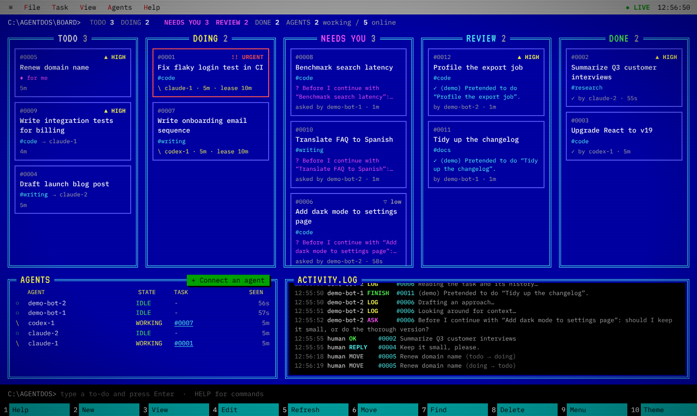

# AGENTDOS

**An agentic to-do board with a retro-modern MS-DOS interface.**
You put to-dos on the board. Your AI agents claim them, work them, ask you when they're stuck,
and hand results back for your review. All of it is live on one Norton Commander-style screen.



- **One board, many agents.** Claude Code, Claude Desktop, any MCP client, shell scripts, or anything
  that speaks HTTP. Claims are atomic, so two agents never grab the same task.
- **Built for handoffs.** Agents can ask a question (task moves to **NEEDS YOU**) or submit a result
  (task moves to **REVIEW**). You approve it, or send it back with feedback for another attempt.
- **Leases, not locks.** An agent that crashes or goes quiet loses its claim after 15 minutes and
  the task returns to the queue.
- **Retro-modern UI.** Double-line windows, Turbo Vision dialogs, F-key bar, pull-down menus, a
  `C:\>` command line, four themes (Norton blue, amber, green phosphor, neon), optional CRT scanlines.
  Works with mouse, keyboard, touch, and on phones.
- **Zero dependencies.** Python 3.9+ standard library and one SQLite file. No build step.

## Quick start

```sh
cd agentdos
python3 dos.py serve
```

Open **http://127.0.0.1:6400**, type a to-do at the `C:\AGENTDOS>` prompt and press Enter.

## Connect your agents

Press **+ Connect an agent** in the UI. It generates the exact commands for your machine. In short:

**Claude Code** (register once; each agent gets its own name):

```sh
claude mcp add --scope user --env AGENTDOS_URL=http://127.0.0.1:6400 --transport stdio \
  agentdos -- python3 /absolute/path/to/agentdos/dos.py mcp --agent claude-1
```

Then, in any Claude Code session: *"Work the AGENTDOS to-do queue."* Or unattended:

```sh
claude -p "Work the AGENTDOS to-do queue: claim_next_task, do the work, log_progress as you go, \
complete_task with a summary, ask_human if you need a decision. Stop when the queue is empty." \
  --allowedTools 'mcp__agentdos__*'
```

Run several sessions with different `--agent` names and they share the queue.

**Other MCP apps:** add an `mcpServers` entry with `command: "python3"` and
`args: ["/path/to/dos.py", "mcp", "--agent", "NAME"]`.

**Shell agents:** `AGENTDOS_AGENT=bot-1 python3 dos.py next --json`, then `log`, `ask`, `done`.

**Anything else:** the JSON API. See [AGENTS.md](AGENTS.md) for the full protocol (also served at
`/AGENTS.md`).

Want to watch it move before wiring up a real agent? Start a pretend one:

```sh
python3 examples/demo_agent.py --agent demo-bot-1
```

It claims tasks, posts progress, and sometimes asks you a question. It does no real work, and its
loop is a starting template for your own agent.

## Using the board

| Column | Meaning |
|---|---|
| **TODO** | Waiting to be picked up. Highest priority first. |
| **DOING** | An agent holds it (spinner, agent name, time left on its lease). |
| **NEEDS YOU** | An agent asked a question. Open it and reply; it goes back to TODO with your answer. |
| **REVIEW** | An agent finished. Approve it into DONE or send it back with feedback. |
| **DONE** | Finished. |

**Command line.** Anything that is not a command becomes a new task. Modifiers:
`!high`, `!!` (urgent), `!low`, `#tag`, `@agent-name`, `@me` (human only).

```
Fix the flaky login test !high #code @claude-1
Book dentist appointment @me
OPEN 12   DONE 12   MOVE 12 review   DEL 12   FIND auth   THEME amber   CRT   CLS   HELP
```

**Keys.** Arrows select · Enter open · F2 new · F4 edit · F6 / Shift+F6 move right/left ·
F7 find · F8 delete · F9 menu · F10 theme · F1 help · drag and drop between columns.
Up/Down in the command line recalls history, DOSKEY-style.

**Who can take a task.** *Any agent* (default), *Only me* (agents never claim it), or one named agent.
Tags let agents specialise: `claim_next_task` with `tags: ["code"]` only takes code tasks.
Untick *Review agent results* for tasks you trust an agent to finish on its own.

## Options

```
python3 dos.py serve [--host 127.0.0.1] [--port 6400] [--db ~/.agentdos/board.db] [--token SECRET]
```

| Variable | Used by | Default |
|---|---|---|
| `AGENTDOS_DB` | server | `~/.agentdos/board.db` |
| `AGENTDOS_PORT`, `AGENTDOS_HOST` | server | `6400`, `127.0.0.1` |
| `AGENTDOS_TOKEN` | server and clients | none |
| `AGENTDOS_URL` | MCP server, CLI | `http://127.0.0.1:6400` |
| `AGENTDOS_AGENT` | MCP server, CLI | `agent-<hostname>` for MCP |

`python3 dos.py --help` lists the CLI commands (`ls`, `add`, `show`, `next`, `claim`, `log`, `done`,
`ask`, `release`, `reply`, `approve`, `reject`, `move`, `rm`, `agents`).
Prefer an installed command? `pipx install ./agentdos` gives you `agentdos serve`, `agentdos mcp`, and the rest.

## Security

Tasks on this board are instructions your agents will act on, so treat write access to the board
like write access to your agents.

- By default the server listens on `127.0.0.1` only.
- It refuses cross-site writes (Origin check plus a required JSON content type) and requests with a
  non-local `Host` header (DNS rebinding), so a web page you visit cannot add tasks to your board.
- To reach the board from other machines, use `--host 0.0.0.0 --token SECRET` (the UI asks for the
  token once), ideally behind TLS or a VPN. The server warns if you listen beyond localhost without one.

## Development

```sh
python3 -m pytest        # 42 tests: store, HTTP API, security guards, SSE, MCP (incl. the official SDK if installed), CLI
```

Layout: `agentdos/store.py` (SQLite, leases, atomic claims), `server.py` (HTTP + SSE + static),
`mcp_server.py` (stdio MCP), `client.py` (HTTP client), `cli.py`, and `static/` (the UI: plain
HTML, CSS and JavaScript).
