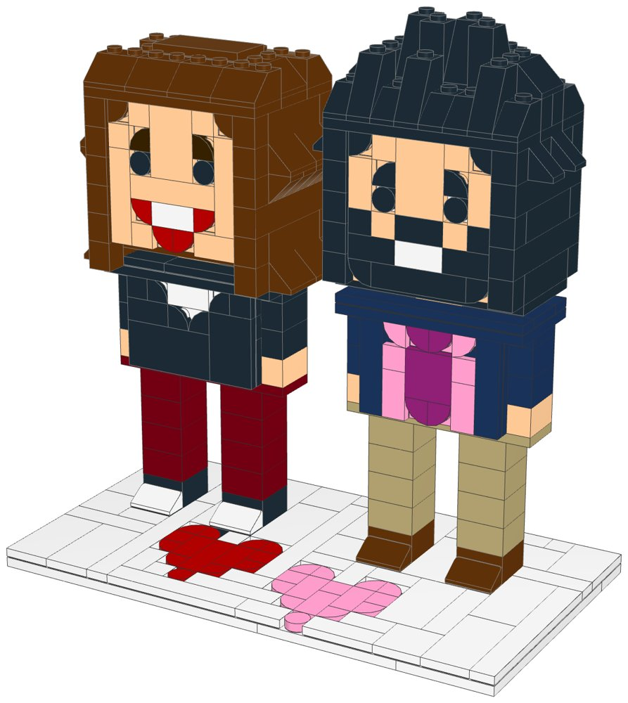
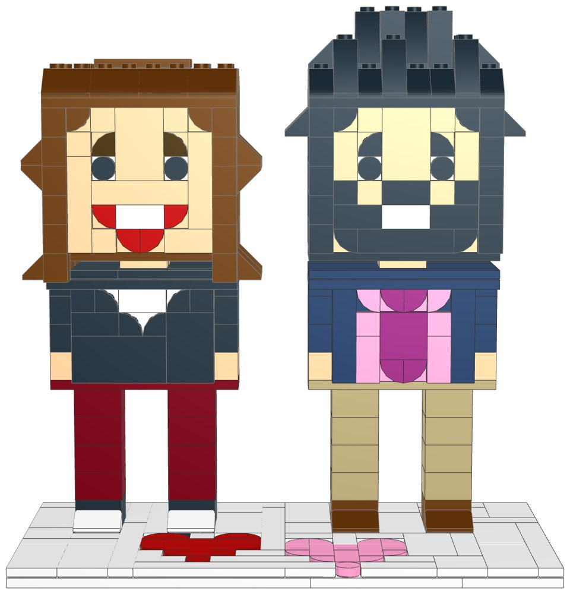
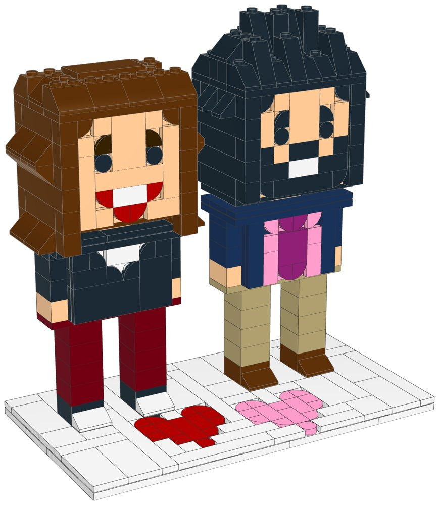
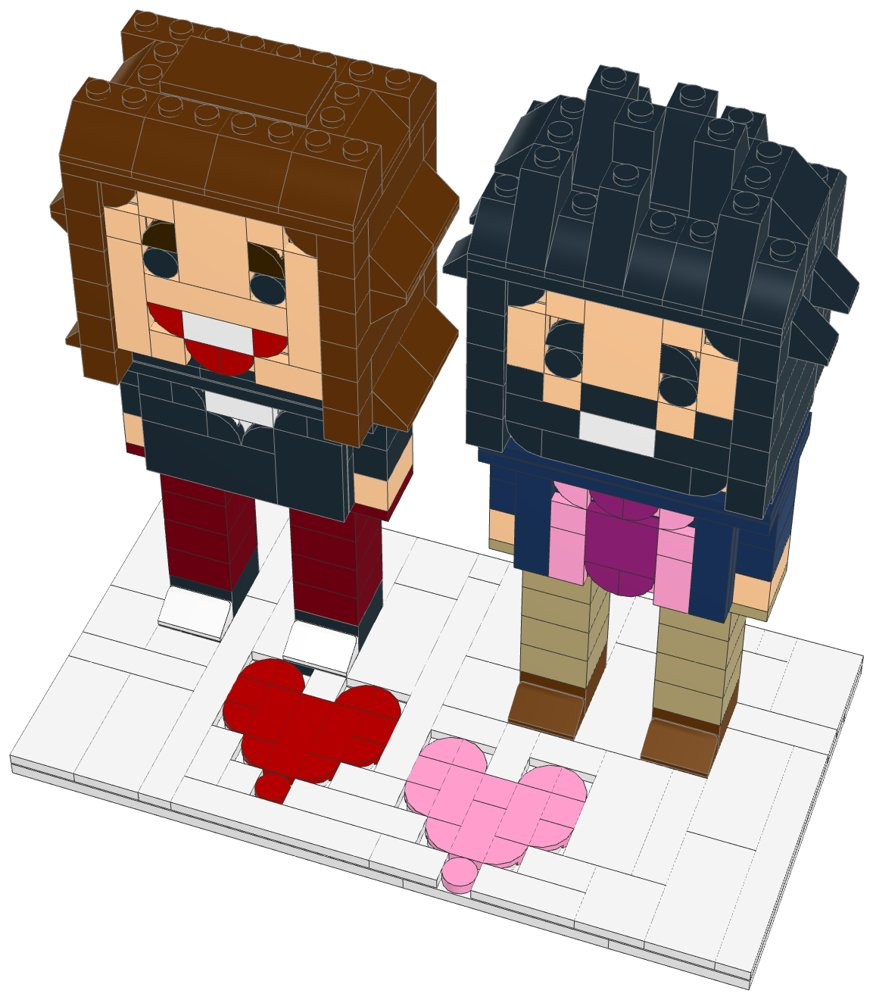
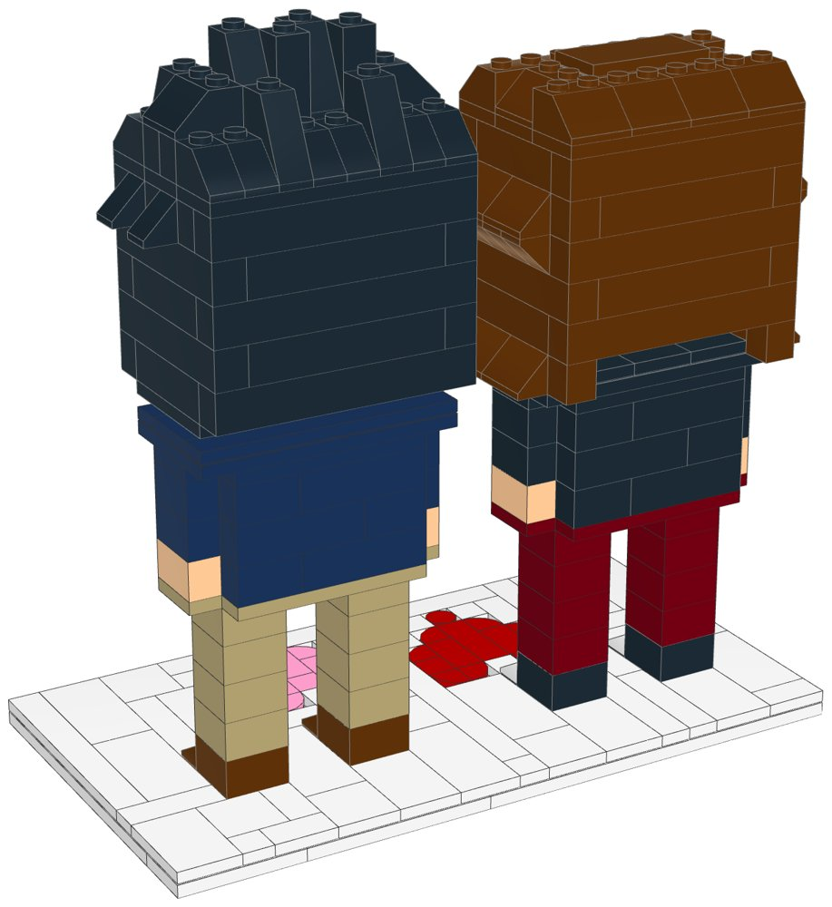

# Brick Portrait: Couple

**A LEGO® portrait figure kit with build instructions.**



A buildable LEGO kit of two brick-built portrait figures, a couple side by side on a white display base, designed from a photo of two custom portrait figures. Each figure is chunky and about 16–18 cm tall: a big near-cube head with a flat tiled face and brick-built hair, a short neck, a blocky torso with the outfit in tiles, arms down at the sides ending in hands, two legs and shoes.

- **The woman** (on the left in the photo): Light Nougat skin, wavy shoulder-length Reddish Brown hair, a Black top with a White V-neck, Dark Red trousers, Black shoes with White toe caps
- **The man** (on the right): Light Nougat skin, short spiky Black hair, a Black beard, a Dark Blue blazer over a Bright Pink shirt and Magenta tie, Tan trousers, Reddish Brown shoes
- A white base of 22 × 12 studs (17.6 × 9.6 cm), tiled, with a red and a pink tile heart at the front.

The kit is sold as a pack of parts with a PDF booklet. Every part is a real LEGO element on Pick a Brick's Bestseller list (up to 999 of an element per order), and one file uploads the whole list for 1, 10 or 25 kits. The figures come from the shared generator [`../lego-kit/portrait.py`](../lego-kit/portrait.py): each one is a few lines of options, which is how a seller makes a custom figure from a customer's photo (see [Custom orders](#making-a-custom-figure-from-a-customer-photo)).

| | |
|---|---|
| Pieces | **423** (93 part/colour lines, 37 kinds of part, 11 colours) |
| Figures | 2, each 8 studs (6.4 cm) wide with a 6 × 6-stud face; the woman 174 pieces, 17 cm tall, the man 170 pieces, 18 cm tall |
| Overall size | 17.6 × 9.6 cm, 18.4 cm tall on its base |
| Instructions | 61-page PDF, 69 steps, 9 sections |
| Parts cost | **$55.49 per kit** at the US Pick a Brick prices of 2026-10-17 (a snapshot of the Bestseller list); prices and stock change (see [Cost assumptions](#cost-assumptions-and-resale-scenarios)) |
| Cost per figure | the woman **$20.99**; the man **$21.38**; the base $13.12 |
| Kits per order | up to **33** (the most-used part is needed 30 times) |



## The figures

Each figure is made by `portrait.Figure` in [`design.py`](design.py):

```python
WOMAN = pt.Figure('woman', 'The woman',
    skin=pt.LNOUGAT,
    hair='wavy',
    hair_colour=pt.RBROWN,
    top='vneck',
    top_colour=pt.BLACK,
    accent=pt.WHITE,
    bottoms='trousers',
    bottoms_colour=pt.DKRED,
    shoes=pt.BLACK,
    toe=pt.WHITE)
MAN = pt.Figure('man', 'The man',
    skin=pt.LNOUGAT,
    hair='spiky',
    hair_colour=pt.BLACK,
    beard=True,
    top='shirt_tie',
    top_colour=pt.DKBLUE,
    shirt=pt.BPINK,
    tie=pt.MAGENTA,
    bottoms='trousers',
    bottoms_colour=pt.TAN,
    shoes=pt.RBROWN)
```

| Figure | Pieces | Part/colour lines | Parts cost |
|---|---|---|---|
| The woman | 174 | 47 | $20.99 |
| The man | 170 | 50 | $21.38 |

Every figure has the same build: two shoes with toe caps, two 2 × 2 legs (or a skirt), hip plates, a 6 × 3 torso of bricks whose front is a panel of tiles on side studs, two 1 × 2 arms with hands, shoulder plates and tiles, a short 2 × 2 neck, and the head: a floor plate, a wall of side-stud bricks with the 6 × 6 tiled face on it, an inner post, and the hair, which wraps the sides, the back and the top and is built on its own. A figure is about 16 cm tall, 8 studs wide (the hair can flare out to 10) and 6 deep.

## Faces: a brick mosaic, or a printed sticker

The figures in the reference photos have custom-printed faces, which stock LEGO parts can't give. This kit offers two ways round that:

1. **Brick-built mosaic (the default, as in this kit).** The face is a 6 × 6-stud panel of tiles facing forward on side studs (SNOT): black round tiles on white for the eyes, quarter-round tiles for the brows, the hairline and the corners of the smile, white tiles for teeth, and for a beard black tiles round the mouth and jaw. Light Nougat tiles fill the rest.
2. **A printed face sticker (optional, not a LEGO part).** Every tile of the face is flush, so the whole 4.8 × 4.8 cm face is one smooth surface. A seller can print the customer's face (48 × 48 mm, rounded corners) on vinyl sticker paper and put it over the mosaic, or build the face with `face="plain"` (all skin tiles) as a blank for the sticker. The sticker is a separate item the seller makes; it isn't in the parts lists or the cost.

Build the mosaic and offer the sticker as an extra: the figure still looks right without it.

## Options in `portrait.py`

| Option | Choices |
|---|---|
| `skin` | `LNOUGAT` (Light Nougat, the lightest), `MNOUGAT` (Medium Nougat), `TAN`, `RBROWN` (Reddish Brown, the deepest) |
| `hair` | `"short"` (neat), `"spiky"` (short, with spikes on top and at the sides), `"wavy"` (shoulder length, flicked out at the temples and the ends), `"long"` (straight, two studs thick, past the shoulders and over the upper arms) |
| `hair_colour` | `BLACK`, `RBROWN` (auburn or brown), `TAN` (blonde), `DKBROWN`, `WHITE`, `LBG` / `DBG` (grey), `RED`; the brows follow it (`brows=` to change) |
| `beard` | `True` for sideburns, a moustache and a beard round the mouth, in `beard_colour` (default: the hair colour) |
| `face` | `"mosaic"` (default: eyes, brows and mouth in tiles) or `"plain"` (all skin tiles, for a printed sticker); `smile=False` for a closed mouth, `nose=True` for a two-stud nose, `hairline=` `"corners"`, `"fringe"` or `None`, `eyes=` and `lips=` colours, or `face_rows=[...]` for a hand-drawn 6 × 6 face |
| `top` | `"vneck"` (`top_colour` with an `accent` V-neck), `"shirt_tie"` (a `top_colour` blazer over a `shirt` and `tie`), `"dress"` (a V-neck top in the dress colour with bare arms) or `"plain"`; `v_depth=2` or `3` rows; `sleeves=` (default: the top colour, skin for a dress) |
| `bottoms` | `"trousers"` (two 2 × 2 legs) or `"skirt"` (a 6 × 4 block down to the shoes), in `bottoms_colour` |
| `shoes` | the shoe colour, and `toe=` for a toe cap in another colour |

All four skin tones are on the Bestseller list. Light Nougat, the lightest, is used for the figures in this kit; Medium Nougat, Tan and Reddish Brown cover medium to deep skin. Each colour and part the generator uses is checked against the Bestseller tables in `portrait.py` (from the US list of 17 October 2026). A choice that isn't a Bestseller (a hair colour without 45° slopes, say) stops the build with a message naming the option to change. `Figure.summary()` describes a figure in words, for the order confirmation.

## Making a custom figure from a customer photo

1. **Pick the options** from the photo, with the customer's permission to make their likeness: skin tone, hair style and colour, beard, the top and its colours, trousers or skirt, shoes. Copy this kit's folder, change the `pt.Figure(...)` lines in `design.py` (and the title), and check the look with `xvfb-run -a python3 ../lego-kit/preview.py .`, which renders it in a minute. For glasses, freckles or a different smile, draw the face as `face_rows=[...]` (six rows of six tokens; see the notes at the top of `portrait.py`).
2. **Run `./build.sh`** with `DATA_DIR` set: it renders every step, maps the parts to LEGO element IDs, checks the model, prints the booklet and writes the parts lists and this README.
3. **Order the parts:** upload `parts/pick_a_brick_upload.csv` (or the 10- or 25-kit file) to Pick a Brick and check the total.
4. **Print the extras (optional):** a 48 × 48 mm face sticker for each figure, on sticker paper. They aren't LEGO parts.
5. **Pack** the parts by section (`parts/parts_by_section.csv`) with a card linking to the PDF booklet.

**Cost per extra figure:** a figure's parts cost about $20.99 to $21.38 (its 170–174 pieces, shoulders included). A kit with one more figure also needs a base about 11 studs wider, a few dollars more of plates and tiles.

## What's in this folder

| Path | What it is |
|---|---|
| [`instructions/Brick_Portrait_Couple_Instructions.pdf`](instructions/Brick_Portrait_Couple_Instructions.pdf) | **The instruction booklet**: cover, section intros with parts lists, 69 numbered steps, gallery, parts inventory with element IDs, ordering guide |
| [`parts/pick_a_brick_upload.csv`](parts/pick_a_brick_upload.csv) | Pick a Brick upload file for **one kit** (93 element IDs) |
| [`parts/pick_a_brick_upload_x10.csv`](parts/pick_a_brick_upload_x10.csv), [`parts/pick_a_brick_upload_x25.csv`](parts/pick_a_brick_upload_x25.csv) | Upload files for **10 kits** (4,230 pieces) and **25 kits** (10,575 pieces) |
| [`parts/kit_cost.csv`](parts/kit_cost.csv) | Cost of one kit, line by line, with the price and when it was seen |
| [`parts/pick_a_brick_list.csv`](parts/pick_a_brick_list.csv) | Bill of materials: element ID, quantity, part, LEGO colour, design ID, BrickLink part and colour |
| [`parts/pick_a_brick_mapping.csv`](parts/pick_a_brick_mapping.csv) | Part-by-part sourcing: Pick a Brick name, evidence it's sold, price, the ID to try next, BrickLink backup |
| [`parts/bricklink_wanted_list.xml`](parts/bricklink_wanted_list.xml), [`parts/rebrickable_parts.csv`](parts/rebrickable_parts.csv) | BrickLink wanted list and Rebrickable import (one kit) |
| [`parts/parts_by_section.csv`](parts/parts_by_section.csv) | Parts for each section, for bagging |
| [`model/brick_portrait_couple.mpd`](model/brick_portrait_couple.mpd) | The digital model (LDraw, with steps and submodels). Opens in BrickLink Studio, LeoCAD and LDCad |
| [`checks.md`](checks.md) | Results of the digital build checks |
| [`design.py`](design.py) | The kit: the figures' options, the base and the layout |
| [`readme.py`](readme.py) | Writes this README from the build outputs |

## Ordering the parts

1. On lego.com, open **Pick and Build → Pick a Brick** and choose **Upload list**.
2. Upload the file for 1, 10 or 25 kits.
3. Before you pay, check that every line shows the normal (Bestseller) delivery time and compare the bag total with the cost below.
4. If a line isn't matched, use the ID in the "If not found" column of the mapping, multiplied by the number of kits.

**Kits per order:** the part this kit uses most is needed 30 times, so one order holds up to **33 kits**.

**Sourcing evidence** (every part passes the Bestseller-only check in `export_parts.py`):

| Evidence | Lines |
|---|---|
| On the US Pick a Brick Bestseller list, available (2026-10-17 snapshot) | 93 |

The Bestseller list is a snapshot of what was available on one day, with prices but no stock counts. A part can sell out or change price, so upload the list before quoting a customer.

## Cost assumptions and resale scenarios

These are planning numbers, not quotes: the bag total on Pick a Brick is the real parts cost.

| Assumption | Value |
|---|---|
| Parts | the US Pick a Brick prices of 2026-10-17 (a snapshot of the Bestseller list); prices and stock change, and the snapshot has no stock counts |
| Parts, stress case | +10% on those prices (LEGO repriced about a third of Pick a Brick elements on September 14, 2026, by 16.7% on average) |
| Packaging | $3.00 per kit: box, bags, a card with a link or QR code to the PDF booklet, tape and label (a printed colour booklet adds about $4.00) |
| Labour | $15.00/hour; 3 s per piece to count and bag from sorted stock, plus 6 min to pack |
| Etsy fees (US) | $0.20 listing + 6.5% transaction + 3% + $0.25 processing, on the price the buyer pays |
| Shipping | seller-paid (free shipping) $10.50 for a 1-2 lb box by USPS Ground Advantage; or the buyer pays postage |
| Prices | 1.6x / 2x / 2.5x the parts cost at today's prices, rounded up to $x9.99; market prices for custom portrait figures were not researched |

| Per kit | Today's prices | Stress case |
|---|---|---|
| Parts | $55.49 | $61.04 |
| Packaging | $3.00 | $3.00 |
| Labour (423 pieces) | $6.79 | $6.79 |
| Before shipping | $65.28 | $70.83 |
| Seller-paid shipping | $10.50 | $10.50 |

Biggest cost lines: 30× Brick 1 x 2 x 1 2/3 with Studs on 1 Side (White) $5.70, 3× Plate 6 x 12 (White) $5.43, 18× Slope 45 2 x 2 (Reddish Brown) $1.98.

| Price | Free shipping (seller pays): profit | margin | Buyer pays postage: profit | margin |
|---|---|---|---|---|
| $89.99 | $5.21 | 6% | $14.72 | 16% |
| $119.99 | $32.36 | 27% | $41.87 | 35% |
| $139.99 | $50.46 | 36% | $59.97 | 43% |

Break-even price: $84.23 with free shipping, $73.73 when the buyer pays postage. The stress case adds $5.55 per kit. The kit packs into a box of about 16 × 12 × 6 cm (the longest part, a 6 × 12 base plate, is under 10 cm); check the shipping weight and size band before setting a free-shipping price. A printed face sticker or photo adds its own small cost.

## Digital checks and physical prototype

`lego-kit/checks.py` checked the digital model ([`checks.md`](checks.md)):

| Check | Result |
|---|---|
| Collisions | Pass |
| Connections | Pass |
| Assembly order | Pass |
| Stability | Pass |

The faces, the torso fronts sit on side studs, which the grid checks can't see, so `portrait.check_snot()` also tests every side-stud part for collisions with the rest of the model (none). **No physical prototype has been built.** Before selling, build one kit from the uploaded parts and the printed booklet. Check that the head sits firmly on its 2 × 2 neck and inner post, that the hair cap presses down evenly over the head, that the arms stay put under the shoulder plates, and that the figures stand steadily on the base.

## Building notes

- **Sections:**
  1. The display base, with its two tile hearts
  2. The woman: shoes and legs, torso, arms, shoulders, head and hair
  3. The man: shoes and legs, torso, arms, shoulders, head and hair
- **The woman's hair** comes down to her shoulders. It flicks out at the temples (an inverted slope under a slope) and at the ends, and its sides rest on the shoulder plates.
- **The man's hair** is short: jagged rows of 45° and 65° slopes over a raised crest, spikes out at the sides above the temples. His beard is in the face mosaic, and the sides of his head are black.
- **Torso fronts:** the woman's black top has its white V-neck in white tiles with black quarter-round tiles along the edges. The man's navy blazer is open over two strips of pink shirt; his magenta tie has a rounded knot and tip.
- **Joints:** the legs and shoes are 2 × 2 stacks. The hip plates run across both legs and out under the arms, the shoulder plates lock the arms at the top, and the head sits on a 2 × 2 neck. Inside the head, a post of 2 × 2 bricks holds the middle of the hair.







Sample booklet pages: [a section page](images/sample_section_page.jpg) and [a step page](images/sample_step_page.jpg).

## How it was made

The figures are generated by [`../lego-kit/portrait.py`](../lego-kit/portrait.py) from the options in [`design.py`](design.py), with the shared toolkit in [`../lego-kit`](../lego-kit). The toolkit builds on the stud grid with the real part shapes from the LDraw library and checks that no two elements overlap and that every element is held by at least one stud. `./build.sh` renders the steps with LeoCAD, maps every part to LEGO element IDs, writes the parts lists and upload files, runs the checks, prints the booklet and writes this README.

```bash
DATA_DIR=/path/to/element-data ./build.sh   # see ../lego-kit/README.md
```

## Disclaimer

An unofficial fan design (MOC). It is not affiliated with, sponsored or endorsed by The LEGO Group. LEGO® is a trademark of The LEGO Group. The brick portrait style here is this shop's own design and uses no other shop's names or branding. A custom figure is a likeness of a real person and is made only with that person's permission. A printed face sticker or photo print is a separate, non-LEGO item made by the seller.
