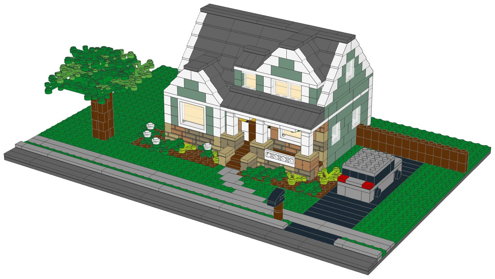
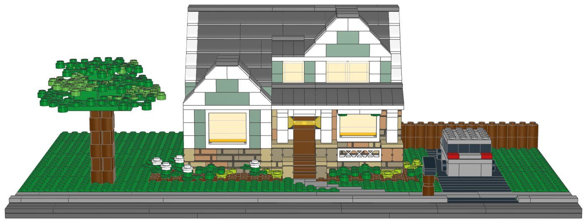
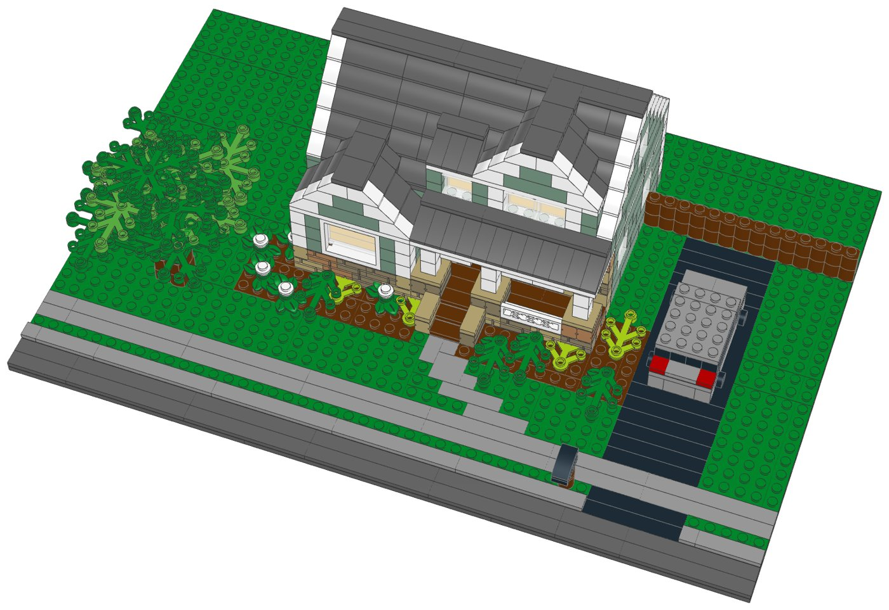
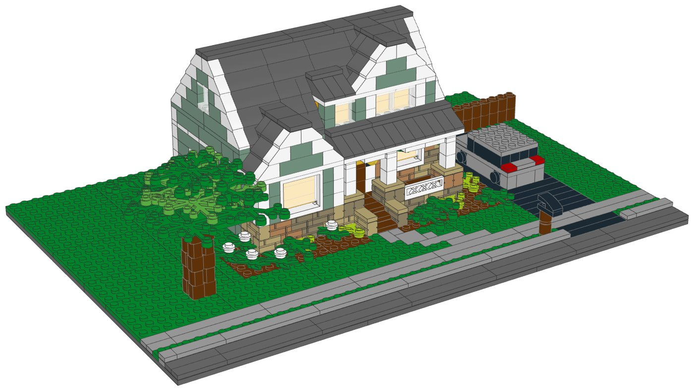
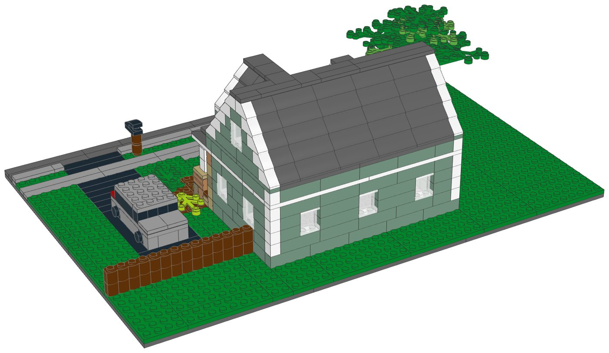

# Craftsman Bungalow: LEGO® model with build instructions



A buildable LEGO model of a one-and-a-half-storey Craftsman bungalow, designed from a
photo of the house seen from the street. It includes:
- sage-green siding with white trim (corner boards, window casings, the porch beam and the
  eave band) under a dark grey roof
- the front-gable bay on the left, with its stacked-stone skirting, a wide lit window and a
  white-trimmed gable
- the big front-gable dormer with its lit double window, and the small shed dormer beside it
- the porch across the right of the front: a stone back wall with the wooden door, its
  glass panel and two porch lights, three chunky stone piers with white columns, the white
  railing, two hanging ferns, and two steps between stone cheeks, under a low porch roof
  that runs up into the main side-gable roof
- the lot: the street, curb and sidewalk, the curved walk to the steps, mulch beds with
  hydrangeas, hostas and round shrubs, a big shade tree on the front-left lawn, the mailbox
  on its wooden post, the driveway with a grey SUV, and a wooden privacy fence

Every part is a current LEGO element from Pick a Brick's Bestseller range. The parts list
is mapped to LEGO element IDs, and one file uploads the whole kit; there are upload files
for 10 and 25 kits too.

| | |
|---|---|
| Pieces | **696** (118 part/colour lines, 55 kinds of part, 16 colours) |
| Footprint | 48 × 32 studs (38.4 × 25.6 cm) |
| Height | 12.2 cm to the roof ridge |
| Scale | about 1:76 (1 stud = 2 ft, one storey = 4 bricks), like the [Family Home](../house-lego) |
| Instructions | 57-page PDF, 47 steps, 7 sections |
| Parts cost | **$114.15 per kit** at the Pick a Brick prices last seen (2022 and late 2025); about $125.56 with 2026 price rises (see [Cost assumptions](#cost-assumptions-and-resale-scenarios)) |



## From the photo

| In the photo | In the model |
|---|---|
| Sage/olive lap siding, cream trim | Sand Green bricks (the closest colour with Bestseller bricks; Olive Green has almost none) and white trim |
| Front-gable bay with a wide double window and stone skirting | 8-stud bay with a 1 × 4 × 3 window, an orange "lit room" behind the glass, and two courses of masonry bricks in Tan, Dark Tan and Medium Nougat |
| Big front-gable dormer, small shed dormer to its left | Both stand on the front slope over the porch, with lit windows; the gable dormer's ridge meets the main ridge |
| Full-width porch roof sweeping down from the main roof | A low 33° porch roof under the 45° main roof, separated by a one-brick knee wall |
| Square cream columns on stone piers, spindle railing | White 1 × 1 columns centred on 2 × 2 stone piers (on jumper plates), a white lattice fence |
| Wood door with a glass panel, porch lights, hanging ferns | Reddish Brown door with a Trans-Yellow panel, two black lamps with yellow lenses, two hanging ferns |
| Curved concrete walk, mulch beds, hydrangeas, hostas, round shrubs | A stepped grey walk, Reddish Brown beds, white-topped hydrangeas, Lime hostas, green shrubs |
| Large shade tree on the front-left lawn | A trunk of log bricks and a domed crown of leaves |
| Sidewalk, curb, black mailbox on a post | Grey sidewalk, raised curb, grass strip, a mailbox on a wooden post by the drive |
| Asphalt driveway, grey compact SUV, wooden privacy fence | Black driveway, a generic grey SUV (no brand), a fence of Reddish Brown log bricks |

Left out: the lap-siding texture and window grids, the side wing and garage behind the
house, the porch chairs, the house number, the car's licence plate, the neighbouring houses
and the power lines. The white trim reads heavier than the photo's thin cream boards, and
the lawn is plain green rather than patchy.

## What's in this folder

| Path | What it is |
|---|---|
| [`instructions/Craftsman_Bungalow_Instructions.pdf`](instructions/Craftsman_Bungalow_Instructions.pdf) | **The instruction booklet**: cover, section intros with parts lists, 47 numbered steps, gallery, parts inventory with element IDs, ordering guide |
| [`parts/pick_a_brick_upload.csv`](parts/pick_a_brick_upload.csv) | Pick a Brick upload file for **one kit** (118 element IDs) |
| [`parts/pick_a_brick_upload_x10.csv`](parts/pick_a_brick_upload_x10.csv), [`parts/pick_a_brick_upload_x25.csv`](parts/pick_a_brick_upload_x25.csv) | Upload files for **10 kits** (6,960 pieces) and **25 kits** (17,400 pieces) |
| [`parts/kit_cost.csv`](parts/kit_cost.csv) | Cost of one kit, line by line, with the price and when it was seen |
| [`parts/pick_a_brick_list.csv`](parts/pick_a_brick_list.csv) | Bill of materials: element ID, quantity, part, LEGO colour, design ID, BrickLink part and colour, alternate IDs |
| [`parts/pick_a_brick_mapping.csv`](parts/pick_a_brick_mapping.csv) | Part-by-part sourcing: Pick a Brick name, evidence it's sold, last price, the ID to try next, BrickLink backup |
| [`parts/pick_a_brick_upload_retry.csv`](parts/pick_a_brick_upload_retry.csv) | Newer element IDs for 18 of the parts, for lines the upload doesn't match |
| [`parts/bricklink_wanted_list.xml`](parts/bricklink_wanted_list.xml), [`parts/rebrickable_parts.csv`](parts/rebrickable_parts.csv) | BrickLink wanted list and Rebrickable import (one kit) |
| [`parts/parts_by_section.csv`](parts/parts_by_section.csv) | Parts for each module (lot, house, upper storey and roofs, tree, car), for bagging |
| [`model/craftsman_house.mpd`](model/craftsman_house.mpd) | The digital model (LDraw, with steps and submodels). Opens in BrickLink Studio, LeoCAD and LDCad |
| [`checks.md`](checks.md) | Results of the digital build checks |
| [`design.py`](design.py) | The design, written as code on the stud grid |
| [`build.sh`](build.sh) | Rebuilds the model, renders, parts lists, checks, booklet and README images |

## Ordering the parts

1. On lego.com, open **Pick and Build → Pick a Brick** and choose **Upload list**.
2. Upload the file for 1, 10 or 25 kits.
3. Before you pay, check that every line shows the normal (Bestseller) delivery time and
   compare the bag total with the cost below.
4. If a line isn't matched, use the ID in the retry file or in the "If not found" column of
   the mapping, multiplied by the number of kits.

**Kits per order:** Pick a Brick sells up to 999 of one element per order. The part this kit
uses most (the Sand Green 1 × 4 brick) is needed 52 times, so one order holds up to
**19 kits**.

**Sourcing evidence** (every part passes the Bestseller-only check in `export_parts.py`):

| Evidence | Lines |
|---|---|
| In Pick a Brick Bestseller range (2022 listing); still in LEGO sets in 2026 | 79 |
| On Pick a Brick (late-2025 listing) | 37 |
| In Pick a Brick Bestseller range (2022 listing); still in LEGO sets in 2026 (including sets listed for 2027) | 2 |

**Sourcing uncertainties:**

- 81 lines are backed only by LEGO's 2022 Bestseller list, so their range and price today
  are not confirmed.
- 18 lines have newer element IDs (retry file); an upload may match either.
- Every line is in 10 or more LEGO sets since 2024. The Sand Green 1 × 6 brick (in only 8)
  was designed out; the 16 × 16 base plate (13 sets) and the Bright Green 6 × 5 leaves
  (14 sets) are the thinnest.
- LEGO pauses Standard parts in the US and Canada from November 2, 2026; this kit uses
  none, but check that no line shows a longer delivery time.

lego.com, BrickLink and Rebrickable could not be reached from the environment this was made
in. Availability comes from an August 2026 Rebrickable snapshot and Pick a Brick listings
from 2022 and late 2025. With internet access, `node ../lego-kit/pab_check.cjs .` checks
every element live.

## Cost assumptions and resale scenarios

These are planning numbers, not quotes. Upload the 10-kit file to see today's prices: the
bag total is the real parts cost. The assumptions are the shared ones in
[`../lego-kit/pricing.py`](../lego-kit/pricing.py).

| Assumption | Value |
|---|---|
| Parts, as listed | Pick a Brick prices last seen in LEGO's 2022 Bestseller list and a late-2025 listing (offline data; lego.com could not be reached to check current prices) |
| Parts, 2026 estimate | +10% on the listed prices (stress case +20%); LEGO's September 14, 2026 repricing raised about a third of Pick a Brick elements by 16.7% on average, hitting tiles and small parts hardest |
| Packaging | $3.00 per kit: box, bags, a card with a link or QR code to the PDF booklet, tape and label (a printed colour booklet adds about $4.00) |
| Labour | $15.00/hour; 3 s per piece to count and bag from sorted stock, plus 6 min to pack |
| Etsy fees (US) | $0.20 listing + 6.5% transaction + 3% + $0.25 processing, on the price the buyer pays |
| Shipping | seller-paid (free shipping) $10.50 for a 1-2 lb box by USPS Ground Advantage; or the buyer pays postage |
| Prices | 1.6x / 2x / 2.5x the 2026 parts estimate, rounded up to $x9.99; market prices for custom house kits were not researched |

| Per kit | Listed prices | 2026 estimate | Stress case |
|---|---|---|---|
| Parts | $114.15 | $125.56 | $136.98 |
| Packaging | $3.00 | $3.00 | $3.00 |
| Labour (696 pieces) | $10.20 | $10.20 | $10.20 |
| Before shipping | $127.35 | $138.76 | $150.18 |
| Seller-paid shipping | $10.50 | $10.50 | $10.50 |

Biggest cost lines: 6× Plate 16 x 16 (Dark Stone Grey) $18.24, 52× Brick 1 x 4 (Sand Green)
$8.32, 27× Slope 45 2 x 4 (Dark Stone Grey) $4.86. The lot (base, street, sidewalk,
driveway, beds and lawn) is about $44 of the total, the house and roofs about $61, the tree
about $5 and the car about $4.

| Price | Free shipping (seller pays): profit | margin | Buyer pays postage: profit | margin |
|---|---|---|---|---|
| $209.99 (30¢/piece) | $40.33 | 19% | $49.83 | 24% |
| $259.99 (37¢/piece) | $85.58 | 33% | $95.08 | 37% |
| $319.99 (46¢/piece) | $139.88 | 44% | $149.38 | 47% |

Break-even price: $165.43 with free shipping, $154.93 when the buyer pays postage (2026
estimate). The stress case adds about $11.41 per kit.

## Digital checks and physical prototype

`lego-kit/checks.py` checked the digital model ([`checks.md`](checks.md)):

| Check | Result |
|---|---|
| Collisions | Pass |
| Connections | Pass |
| Assembly order | Pass |
| Stability | Pass |

Every model (the lot and the house, roof, tree and car modules) is one connected piece with
no overlaps, no assembly-order warnings and no stability warnings. The model was checked on
the computer only: parts fit the stud grid without overlaps and every part is held by a
stud. The white porch columns stand half a stud off the grid (see below), so they are
checked as attached parts, like the window glass. **No physical prototype has been built.**
Before selling, build one kit from the uploaded parts and the printed booklet, to confirm
the parts arrive as listed, the build holds together when handled, and each step is clear.

## Building notes

- **Sections:**
  1. The lot: base, street, curb and sidewalk
  2. The house: walls, windows and porch
  3. The upper storey and the roofs
  4. The yard: driveway, walk, mulch beds and lawn
  5. The shade tree
  6. The garden: shrubs and flowers, mailbox and fence
  7. The car
- **Modules:** the house, its upper storey and roofs, the tree and the car are built on
  their own and then set on the lot. The house goes on early: it ties the back base plates
  to the front ones.
- **Walls:** a foundation course and four courses of bricks for the storey. The corners swap
  between the two walls on every course, and the joints are staggered. The bay and the porch
  are stacked stone in masonry-profile bricks; mix the colours as you like.
- **Porch columns:** each white column stands on the single centre stud of a tan 2 × 2
  jumper plate on its stone pier, so it is centred on the pier. Its top stud goes into the
  tube of the white ceiling plate above.
- **Lit windows:** Bright Light Orange bricks stand behind the big windows, so the rooms
  look lit, as in the photo.
- **Roofs:** the main roof (45°), the bay gable and the gable dormer cross each other in
  stepped valleys; the white slopes along the gable edges are the rake trim. One white deck
  carries both dormers. A few hidden grey bricks hold up slopes in the valleys, in a step of
  their own just before the slopes they hold.



| Front left | Back |
|---|---|
|  |  |

## How it was made

The model is generated by [`design.py`](design.py) with the shared toolkit in
[`../lego-kit`](../lego-kit), using the same scale and techniques as the
[Family Home](../house-lego). The toolkit builds on the stud grid using the real part
shapes from the LDraw library, checks that no two elements overlap and that every element
is held by a stud, renders the steps with LeoCAD, maps every part to LEGO element IDs,
writes the parts lists and upload files, runs the checks and prints the booklet.

```bash
./build.sh            # set DATA_DIR to refresh element IDs (see ../lego-kit/README.md)
```

The README is written by hand (`lego-kit/kit_readme.py` is for the resort collection's
format); after a design change, update its numbers from `parts/kit_cost.csv`, `checks.md`
and the booklet.

## Disclaimer

An unofficial fan design (MOC) made from a photo of a Craftsman-style house. It is not
affiliated with, sponsored or endorsed by The LEGO Group. LEGO® is a trademark of The LEGO
Group. The house number and the car's licence plate from the photo are not reproduced, and
the car is a generic SUV with no brand.
