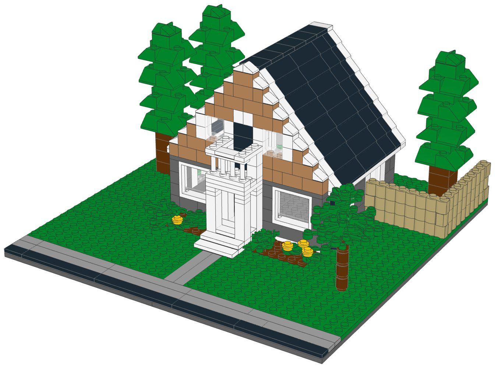
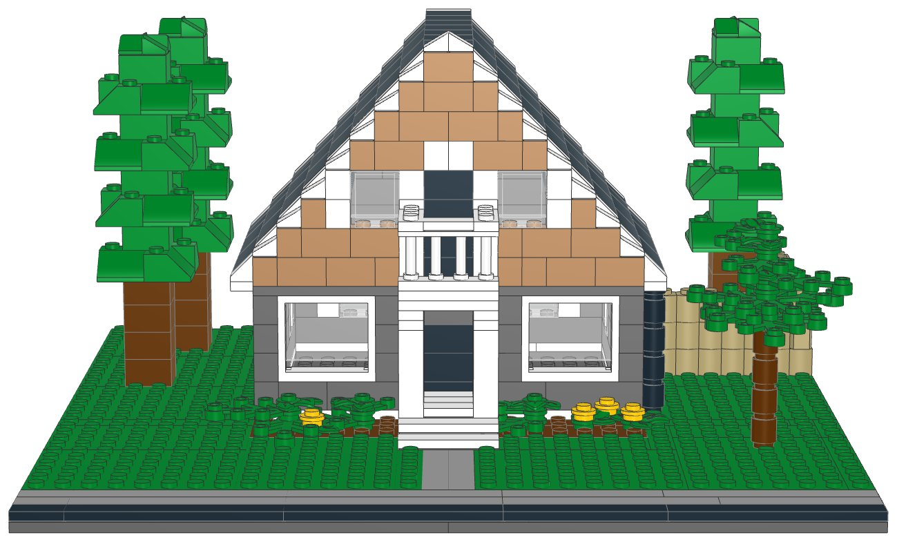
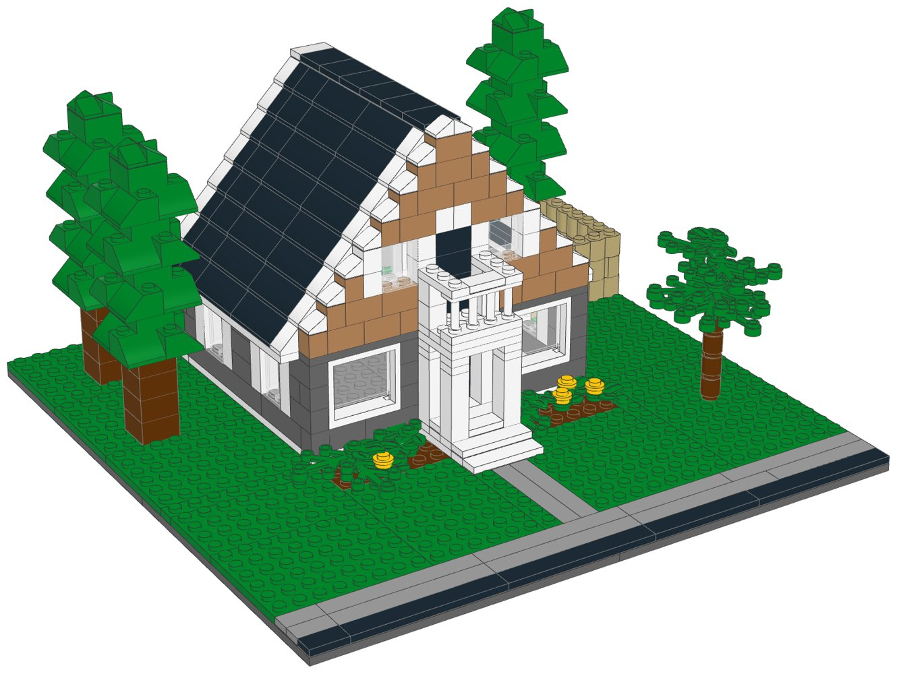
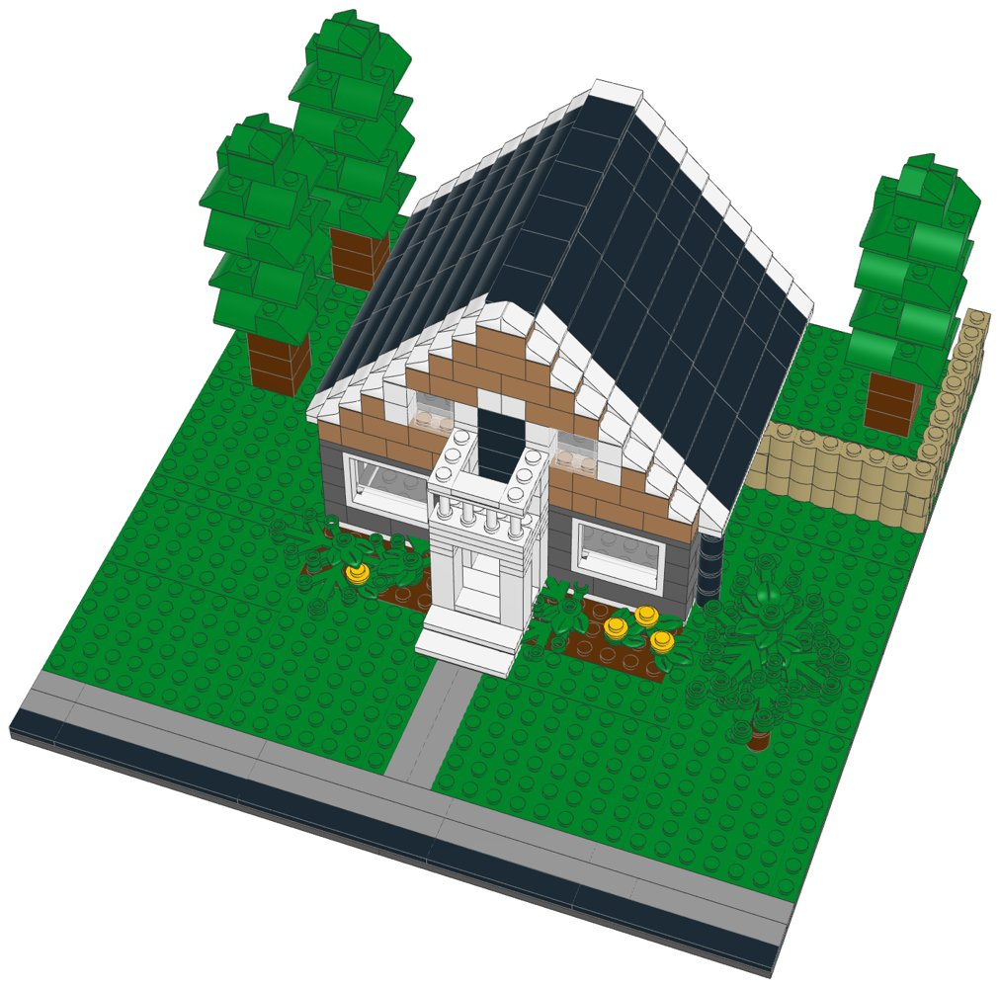
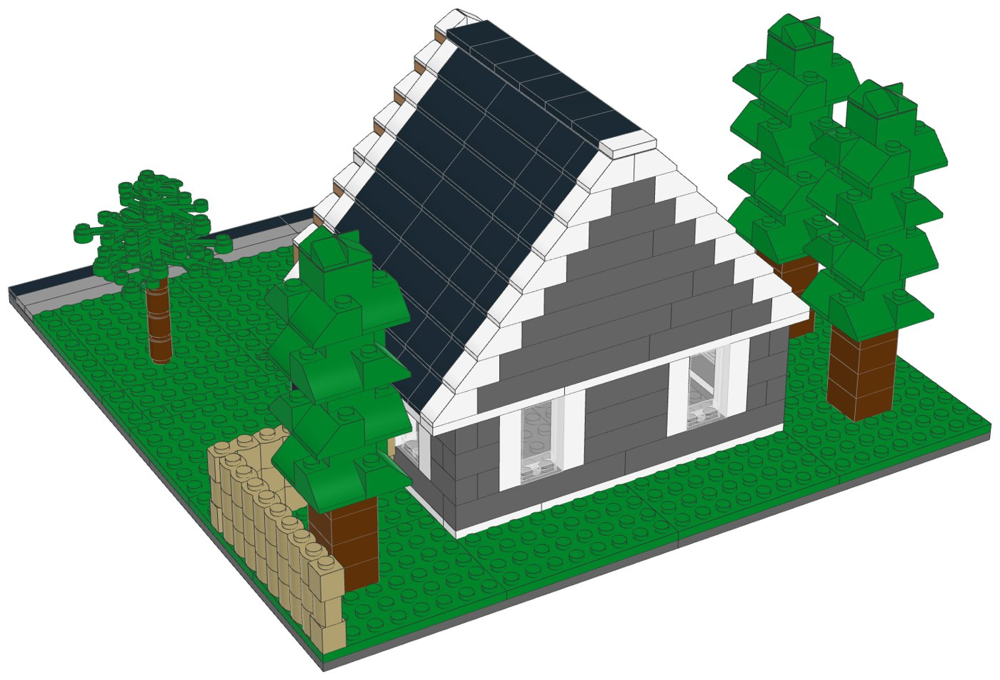

# Gable House: LEGO® model kit with build instructions



A buildable LEGO model of a small one-and-a-half-storey house under one steep front gable, designed from a photo of an imagined home. It includes:
- the steep black roof facing the street, with white trim along both rakes and the eaves
- the half-storey in the gable, clad in warm wood (Medium Nougat), with a black balcony door and a white-trimmed window either side
- the small entry porch on four square white columns; its flat roof is the balcony, with a white spindle railing
- charcoal siding on a white skirt, two white double windows either side of the black front door, two white steps, tall white-trimmed windows down the sides and a black downspout
- the lawn, the concrete walk to the sidewalk and the street, flower beds with shrubs and daffodils, a wooden privacy fence running back from the right side, three tall pines and a young tree

The model is sold as a pack of parts with a PDF booklet. Every part is a real LEGO element from Pick a Brick's Bestseller range, and one file uploads the whole list for 1, 10 or 25 kits.

| | |
|---|---|
| Pieces | **501** (62 part/colour lines, 39 kinds of part, 10 colours) |
| Base | 32 × 32 studs (25.6 × 25.6 cm): four 16 × 16 plates |
| Overall size | 25.7 × 25.6 cm, 13.4 cm tall (the peak of the gable) |
| House | 16 × 14 studs (32 × 28 ft), 18 studs wide across the eaves; a 45° roof |
| Scale | about 1:76 (1 stud = 2 ft, one storey = 4 bricks), like the Family Home |
| Instructions | 41-page PDF, 43 steps, 4 sections |
| Parts cost | **$78.81 per kit** at the Pick a Brick prices last seen (2022 and late 2025); about $86.69 with 2026 price rises (see [Cost assumptions](#cost-assumptions-and-resale-scenarios)) |
| Kits per order | up to **20** (the most-used part is needed 48 times; Pick a Brick sells up to 999 of an element) |



## What's in this folder

| Path | What it is |
|---|---|
| [`instructions/Gable_House_Instructions.pdf`](instructions/Gable_House_Instructions.pdf) | **The instruction booklet**: cover, section intros with parts lists, 43 numbered steps, gallery, parts inventory with element IDs, ordering guide |
| [`parts/pick_a_brick_upload.csv`](parts/pick_a_brick_upload.csv) | Pick a Brick upload file for **one kit** (62 element IDs) |
| [`parts/pick_a_brick_upload_x10.csv`](parts/pick_a_brick_upload_x10.csv), [`parts/pick_a_brick_upload_x25.csv`](parts/pick_a_brick_upload_x25.csv) | Upload files for **10 kits** (5,010 pieces) and **25 kits** (12,525 pieces) |
| [`parts/kit_cost.csv`](parts/kit_cost.csv) | Cost of one kit, line by line, with the price and when it was seen |
| [`parts/pick_a_brick_list.csv`](parts/pick_a_brick_list.csv) | Bill of materials: element ID, quantity, part, LEGO colour, design ID, BrickLink part and colour, alternate IDs |
| [`parts/pick_a_brick_mapping.csv`](parts/pick_a_brick_mapping.csv) | Part-by-part sourcing: Pick a Brick name, evidence it's sold, last price, the ID to try next, BrickLink backup |
| [`parts/pick_a_brick_upload_retry.csv`](parts/pick_a_brick_upload_retry.csv) | Newer element IDs for 17 of the parts, for lines the upload doesn't match |
| [`parts/bricklink_wanted_list.xml`](parts/bricklink_wanted_list.xml), [`parts/rebrickable_parts.csv`](parts/rebrickable_parts.csv) | BrickLink wanted list and Rebrickable import (one kit) |
| [`parts/parts_by_section.csv`](parts/parts_by_section.csv) | Parts for each section, for bagging |
| [`model/gable_house.mpd`](model/gable_house.mpd) | The digital model (LDraw, with steps and submodels). Opens in BrickLink Studio, LeoCAD and LDCad |
| [`checks.md`](checks.md) | Results of the digital build checks |
| [`design.py`](design.py) | The design, written as code on the stud grid |
| [`readme.py`](readme.py) | Writes this README from the build outputs |

## Ordering the parts

1. On lego.com, open **Pick and Build → Pick a Brick** and choose **Upload list**.
2. Upload the file for 1, 10 or 25 kits.
3. Before you pay, check that every line shows the normal (Bestseller) delivery time and compare the bag total with the cost below.
4. If a line isn't matched, use the ID in the retry file or in the "If not found" column of the mapping, multiplied by the number of kits.

**Kits per order:** the part this kit uses most is needed 48 times, so one order holds up to **20 kits** (the 25-kit file needs two orders, or ask LEGO customer service).

**Sourcing evidence** (every part passes the Bestseller-only check in `export_parts.py`):

| Evidence | Lines |
|---|---|
| In Pick a Brick Bestseller range (2022 listing); still in LEGO sets in 2026 | 45 |
| On Pick a Brick (late-2025 listing) | 17 |

**Sourcing uncertainties:**

- 45 lines are backed only by LEGO's 2022 Bestseller list, so their range and price today are not confirmed.
- 17 lines have newer element IDs (retry file); an upload may match either.
- Parts in fewer than 10 sets since 2024 (more likely to sell out): Fence Spindled 1 x 4 x 2 White (7 sets).
- LEGO pauses Standard parts in the US and Canada from November 2, 2026; this kit uses none, but check that no line shows a longer delivery time.

## Cost assumptions and resale scenarios

These are planning numbers, not quotes. Upload the 10-kit file to see today's prices: the bag total is the real parts cost.

| Assumption | Value |
|---|---|
| Parts, as listed | Pick a Brick prices last seen in LEGO's 2022 Bestseller list and a late-2025 listing (offline data; lego.com could not be reached to check current prices) |
| Parts, 2026 estimate | +10% on the listed prices (stress case +20%); LEGO's September 14, 2026 repricing raised about a third of Pick a Brick elements by 16.7% on average, hitting tiles and small parts hardest |
| Packaging | $3.00 per kit: box, bags, a card with a link or QR code to the PDF booklet, tape and label (a printed colour booklet adds about $4.00) |
| Labour | $15.00/hour; 3 s per piece to count and bag from sorted stock, plus 6 min to pack |
| Etsy fees (US) | $0.20 listing + 6.5% transaction + 3% + $0.25 processing, on the price the buyer pays |
| Shipping | seller-paid (free shipping) $10.50 for a 1-2 lb box by USPS Ground Advantage; or the buyer pays postage |
| Prices | 1.6x / 2x / 2.5x the 2026 parts estimate, rounded up to $x9.99; market prices for custom kits were not researched for this kit |

| Per kit | Listed prices | 2026 estimate | Stress case |
|---|---|---|---|
| Parts | $78.81 | $86.69 | $94.57 |
| Packaging | $3.00 | $3.00 | $3.00 |
| Labour (501 pieces) | $7.76 | $7.76 | $7.76 |
| Before shipping | $89.57 | $97.45 | $105.33 |
| Seller-paid shipping | $10.50 | $10.50 | $10.50 |

Biggest cost lines: 4× Plate 16 x 16 (Dark Stone Grey) $12.16, 48× Slope 45 2 x 2 (Dark Green) $6.72, 10× Plate 6 x 8 (Dark Green) $6.70.

| Price | Free shipping (seller pays): profit | margin | Buyer pays postage: profit | margin |
|---|---|---|---|---|
| $139.99 (28¢/piece) | $18.29 | 13% | $27.79 | 20% |
| $179.99 (36¢/piece) | $54.49 | 30% | $63.99 | 36% |
| $219.99 (44¢/piece) | $90.69 | 41% | $100.19 | 46% |

Break-even price: $119.78 with free shipping, $109.28 when the buyer pays postage (2026 estimate). The stress case adds about $7.88 per kit. The 32 × 32 base makes a box of about 28 × 28 cm; check the shipping weight and size band before setting a free-shipping price.

## Digital checks and physical prototype

`lego-kit/checks.py` checked the digital model ([`checks.md`](checks.md)):

| Check | Result |
|---|---|
| Collisions | Pass |
| Connections | Pass |
| Assembly order | Pass |
| Stability | Pass |

The model was checked on the computer only: parts fit the stud grid without overlaps and every part is held by a stud. **No physical prototype has been built.** Before selling, build one kit from the uploaded parts and the printed booklet, to confirm the parts arrive as listed, the build holds together when handled, and each step is clear. Give the front gable extra attention: it is a single-brick-thick wall in front of the roof, held by the studs below it.

## Building notes

- **Sections:**
  1. The lot: base, street, sidewalk, walk, steps and lawn
  2. The house: walls, porch, balcony, gable and roof
  3. The garden: shrubs, daffodils and fence
  4. The pines (build 3) and the front tree
- **Modules:** the house, the pines and the front tree are built on their own and then set on the lot.
- **Ground floor:** four courses of charcoal bricks on a white skirt. The corners swap between the two walls on every course and the joints are staggered, so the walls lock together. The porch stands on the same foundation plates as the walls, and its white roof plate reaches back onto the front wall.
- **Gable and roof:** the wood gable stands on the front wall and the roof starts one stud behind it. The white 1×1 slopes on the gable's end steps and the white 45° slopes at the ends of the roof make the rake trim; the white eave plates make the fascia.
- **Interior:** the house is hollow, so the windows show into it.
- Slide the clear glass into each white window frame before you place it. The clear panels go in with their flat side facing out.







## How it was made

The model is generated by [`design.py`](design.py) with the shared toolkit in [`../lego-kit`](../lego-kit), at the scale of the Family Home in [`../house-lego`](../house-lego). The toolkit builds on the stud grid using the real part shapes from the LDraw library and checks that no two elements overlap and that every element is held by at least one stud, within the house, pine and tree submodels too. `./build.sh` renders the steps with LeoCAD, maps every part to LEGO element IDs, writes the parts lists and upload files, runs the checks, prints the booklet and writes this README.

```bash
./build.sh            # set DATA_DIR to refresh element IDs (see ../lego-kit/README.md)
```

lego.com, BrickLink and Rebrickable could not be reached from the environment this was made in. Availability comes from an August 2026 Rebrickable snapshot and Pick a Brick listings from 2022 and late 2025. With internet access, `node ../lego-kit/pab_check.cjs .` checks every element live.

## Disclaimer

An unofficial fan design (MOC) of a generic house, designed from a photo of an imagined home concept. It is not affiliated with, sponsored or endorsed by The LEGO Group. LEGO® is a trademark of The LEGO Group.
