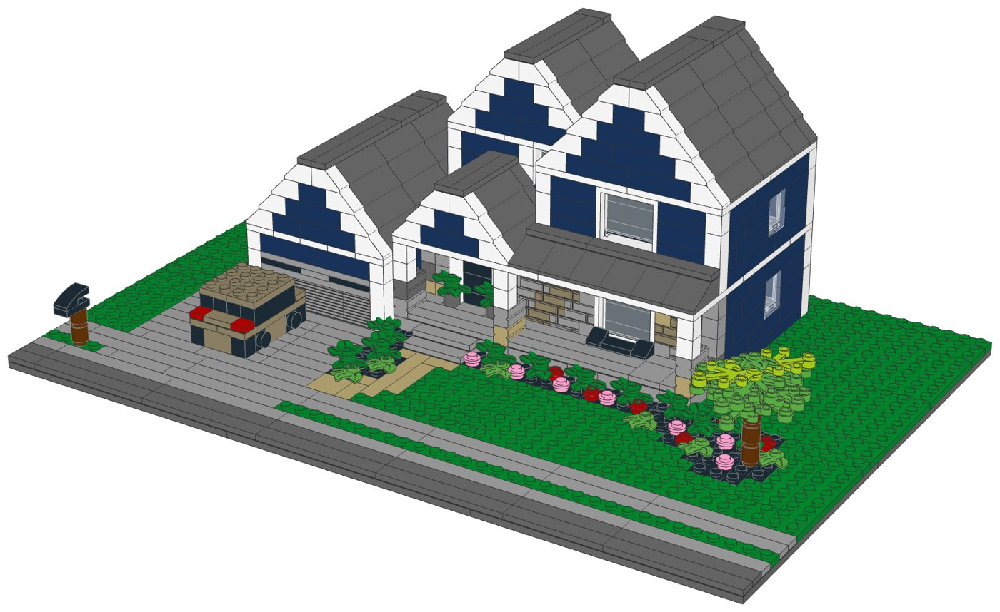
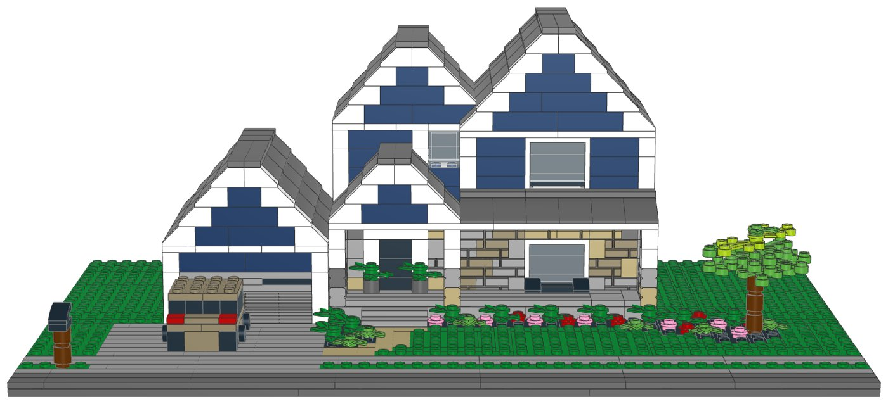
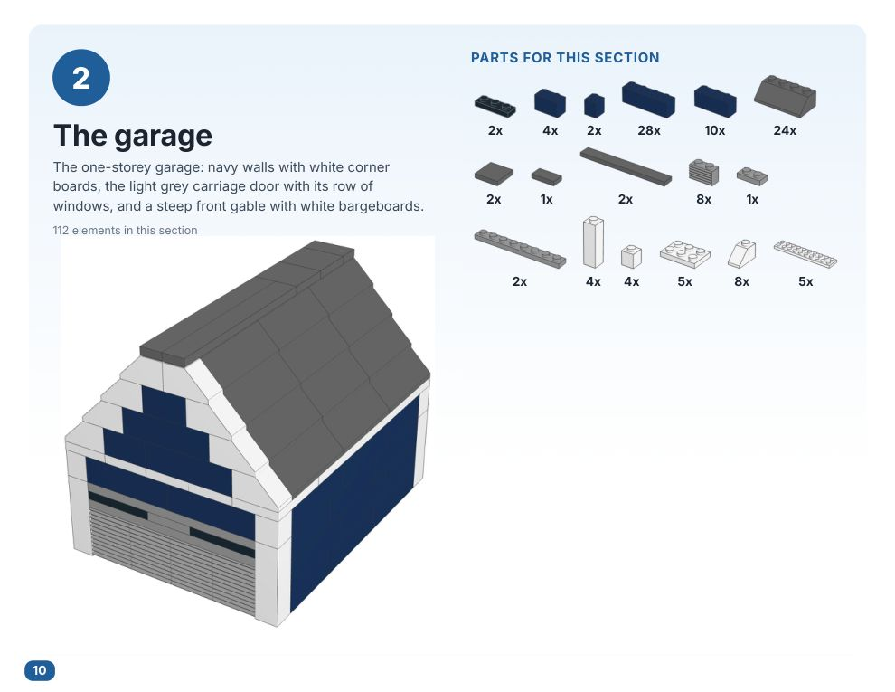
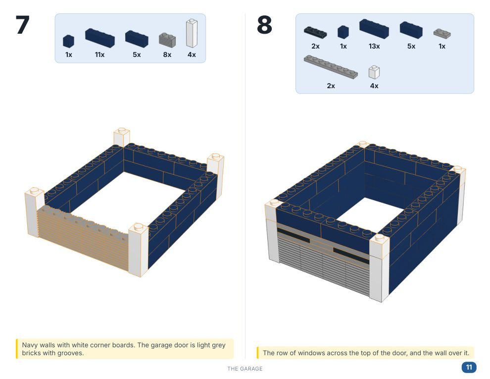
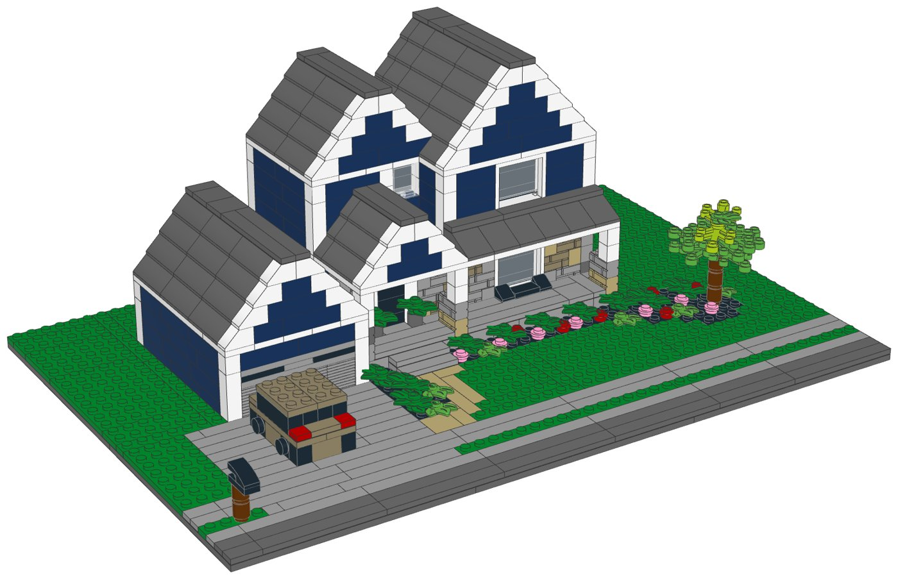
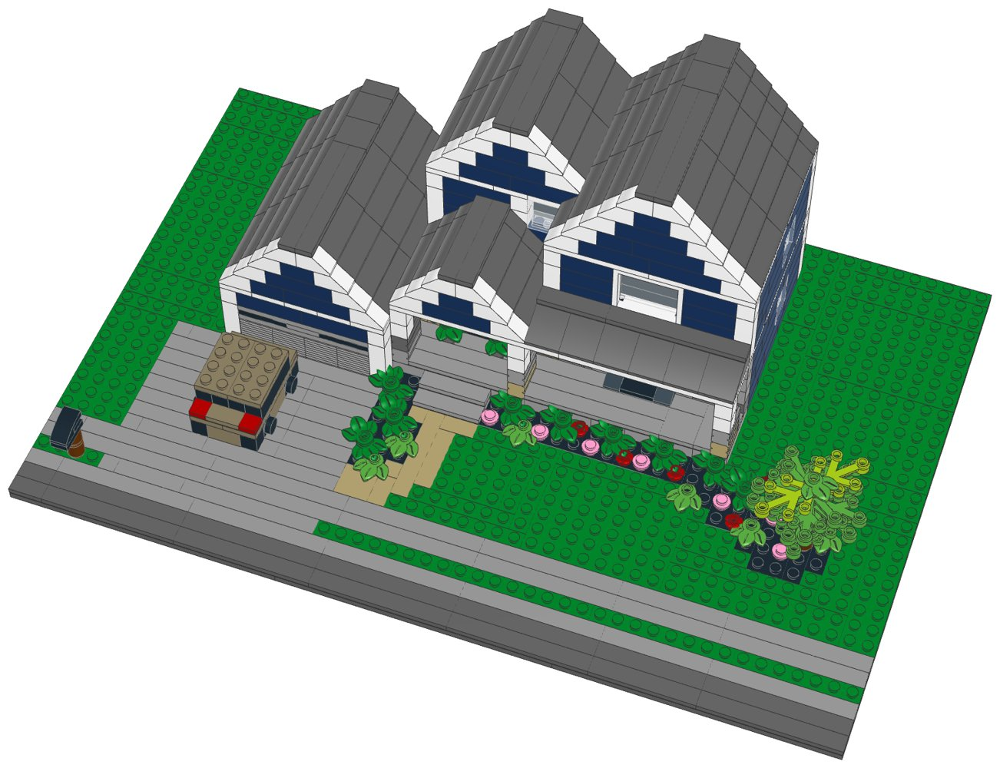
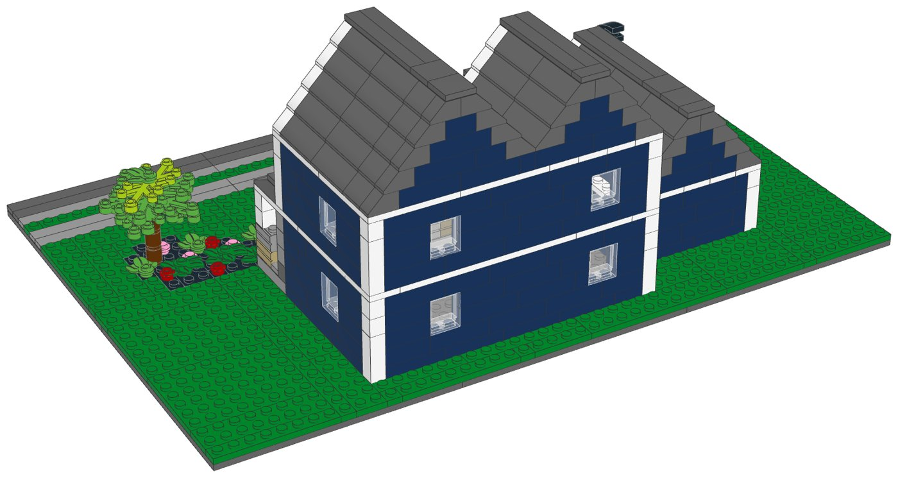

# Navy Craftsman House: LEGO® model with build instructions



A buildable LEGO model of a two-storey modern-craftsman house, designed from a photo and sold as a pack of parts with a PDF instruction booklet. It includes:

- Deep navy walls (Dark Blue) with crisp white corner boards, window frames, fascia, bargeboards and a white band between the storeys
- Two steep front gables nested one behind the other, with white bargeboards and a valley between them
- The one-storey garage under its own front gable, with a light grey carriage door and a row of windows across its top
- The covered porch: white columns on stacked-stone piers, a small front gable over the door and a shed roof over the rest
- A stacked-stone ground floor in four colours, with the black front door, a big white-framed window, two potted plants, two chairs and a little table
- The street, curb, grass strip and sidewalk; the driveway with a bronze compact SUV and a black mailbox on a wooden post
- A curved tan paver walk, black mulch beds with boxwoods, grasses and pink and red flowering shrubs, and a young tree with a bright green canopy

**Left out or simplified**

- The flag on the porch column, the wooden fence and the neighbouring houses
- The board-and-batten texture: the walls and gables are plain navy bricks
- The window grids, the porch lanterns, the house number and the lawn's mowing stripes
- The bargeboards are stepped white slopes, so they are wider than the thin boards on the real house

| | |
|---|---|
| Pieces | **739** (101 part/colour lines, 53 kinds of part, 14 colours) |
| Footprint | 48 × 32 studs (38.4 × 25.6 cm), on six 16×16 base plates |
| Overall size | 38.4 × 25.6 cm, 14.7 cm tall to the roof ridge |
| Scale | about 1:76 (1 stud = 2 ft, one storey = 4 bricks), like [`../house-lego`](../house-lego) |
| Instructions | 42-page PDF, 42 steps, 5 sections |
| Parts cost | **$118.41 per kit** at the Pick a Brick prices last seen (2022 and late 2025); about $130.25 with 2026 price rises (see [Cost assumptions](#cost-assumptions-and-resale-scenarios)) |
| Kits per order | up to **11** (999 per element; the most-used part is needed 84 times) |



## What's in this folder

| Path | What it is |
|---|---|
| [`instructions/Navy_Craftsman_House_Instructions.pdf`](instructions/Navy_Craftsman_House_Instructions.pdf) | **The instruction booklet**: cover, section intros with parts lists, 42 numbered steps, gallery, parts inventory with element IDs, ordering guide |
| [`parts/pick_a_brick_upload.csv`](parts/pick_a_brick_upload.csv) | Pick a Brick upload file for **one kit** (101 element IDs) |
| [`parts/pick_a_brick_upload_x10.csv`](parts/pick_a_brick_upload_x10.csv), [`parts/pick_a_brick_upload_x25.csv`](parts/pick_a_brick_upload_x25.csv) | Upload files for **10 kits** (7,390 pieces) and **25 kits** (18,475 pieces) |
| [`parts/kit_cost.csv`](parts/kit_cost.csv) | Cost of one kit, line by line, with the price and when it was seen |
| [`parts/pick_a_brick_list.csv`](parts/pick_a_brick_list.csv) | Bill of materials: element ID, quantity, part, LEGO colour, design ID, BrickLink part and colour, alternate IDs |
| [`parts/pick_a_brick_mapping.csv`](parts/pick_a_brick_mapping.csv) | Part-by-part sourcing: Pick a Brick name, evidence it's sold, last price, the ID to try next, BrickLink backup |
| [`parts/pick_a_brick_upload_retry.csv`](parts/pick_a_brick_upload_retry.csv) | Newer element IDs for 19 of the parts, for lines the upload doesn't match |
| [`parts/bricklink_wanted_list.xml`](parts/bricklink_wanted_list.xml), [`parts/rebrickable_parts.csv`](parts/rebrickable_parts.csv) | BrickLink wanted list and Rebrickable import (one kit) |
| [`parts/parts_by_section.csv`](parts/parts_by_section.csv) | Parts for each section, for bagging |
| [`model/navy_house.mpd`](model/navy_house.mpd) | The digital model (LDraw, with steps and submodels). Opens in BrickLink Studio, LeoCAD and LDCad |
| [`checks.md`](checks.md) | Results of the digital build checks |
| [`design.py`](design.py) | The design, written as code on the stud grid |
| [`make_readme.py`](make_readme.py) | Writes this README from the parts files, checks and booklet |

## The booklet

The 42-page PDF opens with the model and how the build is organised. Each section starts with a page listing its parts, and every step shows the parts to add outlined in orange, with a callout of the parts and their counts. At the back are a gallery, the full inventory with element IDs and an ordering guide.

| A section page | A step page |
|---|---|
|  |  |

## Ordering the parts

1. On lego.com, open **Pick and Build → Pick a Brick** and choose **Upload list**.
2. Upload the file for 1, 10 or 25 kits.
3. Before you pay, check that every line shows the normal (Bestseller) delivery time and compare the bag total with the cost below.
4. If a line isn't matched, use the ID in the retry file or in the "If not found" column of the mapping, multiplied by the number of kits.

**Kits per order:** Pick a Brick sells up to 999 of one element per order. The part this kit uses most is needed 84 times, so one order holds up to **11 kits**. Some lines of the 25-kit file go over that limit, so split 25 kits into three orders (11 + 11 + 3 kits).

**Sourcing evidence** (every part passes the Bestseller-only check in `export_parts.py`):

| Evidence | Lines |
|---|---|
| In Pick a Brick Bestseller range (2022 listing); still in LEGO sets in 2026 | 69 |
| On Pick a Brick (late-2025 listing) | 29 |
| In Pick a Brick Bestseller range (2022 listing); still in LEGO sets in 2026 (including sets listed for 2027) | 3 |

**Sourcing uncertainties:**

- 72 lines are backed only by LEGO's 2022 Bestseller list, so their range and price today are not confirmed.
- 19 lines have newer element IDs (retry file); an upload may match either.
- LEGO pauses Standard parts in the US and Canada from November 2, 2026; this kit uses none, but check that no line shows a longer delivery time.

## Cost assumptions and resale scenarios

These are planning numbers, not quotes. Upload the 10-kit file to see today's prices: the bag total is the real parts cost.

| Assumption | Value |
|---|---|
| Parts, as listed | Pick a Brick prices last seen in LEGO's 2022 Bestseller list and a late-2025 listing (offline data; lego.com could not be reached to check current prices) |
| Parts, 2026 estimate | +10% on the listed prices (stress case +20%); LEGO's September 14, 2026 repricing raised about a third of Pick a Brick elements by 16.7% on average, hitting tiles and small parts hardest |
| Packaging | $3.00 per kit: box, bags, a card with a link or QR code to the PDF booklet, tape and label (a printed colour booklet adds about $4.00) |
| Labour | $15.00/hour; 3 s per piece to count and bag from sorted stock, plus 6 min to pack |
| Etsy fees (US) | $0.20 listing + 6.5% transaction + 3% + $0.25 processing, on the price the buyer pays |
| Shipping | seller-paid (free shipping) $10.50 for a 1-2 lb box by USPS Ground Advantage; or the buyer pays postage |
| Prices | 1.6x / 2x / 2.5x the 2026 parts estimate, rounded up to $x9.99; market prices for custom kits were not researched for this house |

| Per kit | Listed prices | 2026 estimate | Stress case |
|---|---|---|---|
| Parts | $118.41 | $130.25 | $142.09 |
| Packaging | $3.00 | $3.00 | $3.00 |
| Labour (739 pieces) | $10.74 | $10.74 | $10.74 |
| Before shipping | $132.15 | $143.99 | $155.83 |
| Seller-paid shipping | $10.50 | $10.50 | $10.50 |

Biggest cost lines: 6× Plate 16 x 16 (Dark Stone Grey) $18.24, 84× Brick 1 x 4 (Earth Blue) $13.44, 62× Slope 45 2 x 4 (Dark Stone Grey) $11.16.

| Price | Free shipping (seller pays): profit | margin | Buyer pays postage: profit | margin |
|---|---|---|---|---|
| $209.99 (28¢/piece) | $35.10 | 17% | $44.60 | 21% |
| $269.99 (37¢/piece) | $89.40 | 33% | $98.90 | 37% |
| $329.99 (45¢/piece) | $143.70 | 44% | $153.20 | 46% |

Break-even price: $171.20 with free shipping, $160.70 when the buyer pays postage (2026 estimate). The stress case adds about $11.84 per kit. With 739 pieces and six 16×16 base plates, a boxed kit may weigh more than the 1-2 lb assumed for shipping; weigh the first one.

## Digital checks and physical prototype

`lego-kit/checks.py` checked the digital model ([`checks.md`](checks.md)):

| Check | Result |
|---|---|
| Collisions | Pass |
| Connections | Pass |
| Assembly order | Pass |
| Stability | Pass |

The model was checked on the computer only: parts fit the stud grid without overlaps and every part is held by a stud. **No physical prototype has been built.** Before selling, build one kit from the uploaded parts and the printed booklet, to confirm the parts arrive as listed, the build holds together when handled, and each step is clear.

## Building notes

- **Sections:**
  1. The lot: street, sidewalk, driveway, walk, beds and lawn
  2. The garage
  3. The house: stone front, porch, upper storey and roofs
  4. The garden: shrubs, flowers, the tree and the mailbox
  5. The car (inside the garden section)
- **Modules:** the garage, the house and the car are built on their own and then set on the lot. The garage's side wall also closes the house's ground floor where they meet.
- **Walls:** each storey is four courses of navy bricks, laid two at a time. The corners swap between the walls on every course; the white corner boards are 1×1×3 bricks.
- **Stone front:** masonry-profile 1×2 bricks in tan, dark tan and two greys, mixed like stacked stone, with light grey porch-base bricks running back under it.
- **Windows:** the two big windows are white 1×4×3 frames with clear glass and black bricks behind, so the glass looks dark; the small ones are clear 1×2×2 panels.
- **Roofs:** steep 45° gables. The two upstairs gables are built together: the rear one is set three studs back, and where they cross the slopes step around each other to form the valley. White slopes at the gable fronts are the bargeboards; a few hidden grey 1×1 bricks hold up the slopes in the valley.
- **Floors:** white plates between the storeys make the porch ceiling and a white band round the house; the house is hollow inside.







## How it was made

The model is generated by [`design.py`](design.py) with the shared toolkit in [`../lego-kit`](../lego-kit), the same way as [`../house-lego`](../house-lego). `./build.sh` renders the steps with LeoCAD, maps every part to LEGO element IDs, writes the parts lists and upload files, runs the checks, prints the booklet and writes this README.

```bash
RENDER_WORKERS=1 DATA_DIR=... xvfb-run -a ./build.sh   # DATA_DIR refreshes element IDs (see ../lego-kit/README.md)
```

lego.com, BrickLink and Rebrickable could not be reached from the environment this was made in. Availability comes from an August 2026 Rebrickable snapshot and Pick a Brick listings from 2022 and late 2025. With internet access, `node ../lego-kit/pab_check.cjs .` checks every element live.

## Disclaimer

An unofficial fan design (MOC) made from a photo of a house. It is not affiliated with, sponsored or endorsed by The LEGO Group. LEGO® is a trademark of The LEGO Group. The car is a generic SUV with no brand, and the house number and licence plate in the photo are not reproduced.
