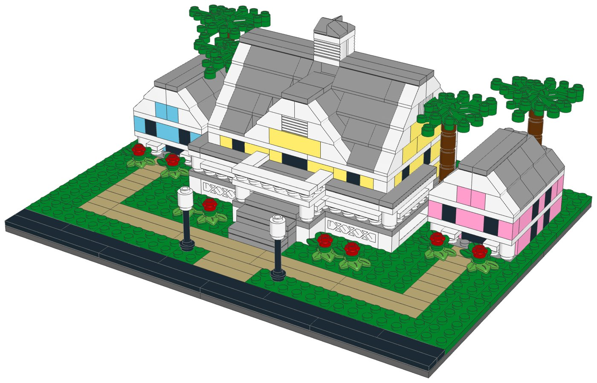
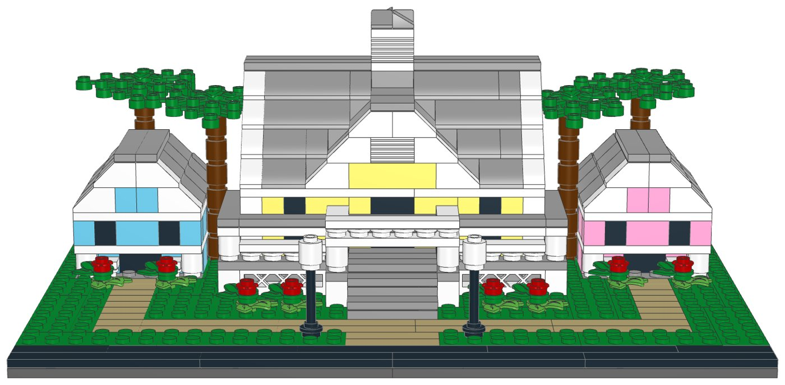
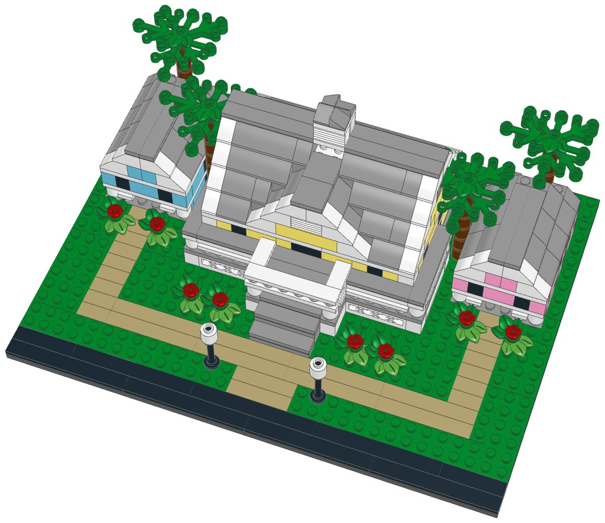

# Old Key West Resort (mid-size): LEGO® display kit with build instructions



A mid-size display model of Disney's Old Key West Resort at Walt Disney World, part of the [resort collection](../resort-collection/README.md). The arrival front of Old Key West, facing the viewer: the Hospitality House as a big Key West house in pale yellow with white corner boards, raised on a white lattice skirt. A white porch with posts and railings wraps round the front and sides under a flat tin porch roof, and the entrance portico carries the balcony over the front door. Above them rise a steep light grey tin roof with white-trimmed gable ends, a front gable with a louvre and the louvred cupola on the ridge. Front steps and a sandy walk lead up from the street between lamp posts and flowering shrubs, and a smaller guest villa stands a little back on each side, one aqua and one pink, with white porches and front-gabled tin roofs, among palms.

**Signature features in this kit**

- The Hospitality House's entrance front, centred and symmetric: two storeys of pale yellow walls with white corner boards on a white lattice skirt
- A white porch with posts and railings across the front and six studs down each side, under a flat grey tin porch roof
- The entrance portico in front of the doors, with the balcony over the front door on its roof
- A steep light grey tin roof: yellow gable ends with white trim and louvres, a front gable with a louvre, and the louvred cupola on the ridge
- Front steps and a sandy walk up to the porch, between lamp posts and flowering shrubs, with paths to the villas
- Two guest villas set a little back on each side, in aqua and pink, with white porches under front-gabled tin roofs
- Four palms beside and behind the villas

**Left out**

- The other villa buildings, the marina, the pools and the golf course
- The shutters and the clapboard siding (shown as plain walls)
- The back of the Hospitality House (the restaurant and the pool deck)

| | |
|---|---|
| Pieces | **575** (64 part/colour lines, 36 kinds of part, 12 colours) |
| Display base | 32 × 24 studs (25.6 × 19.2 cm), the same for every mid-size kit in the collection |
| Overall size | 25.6 × 19.2 cm, 10.5 cm tall |
| Scale | about 1:250 (one storey = 4 plates, 1 stud ≈ 2 m), like the large resort models |
| Instructions | 60-page PDF, 59 steps, 6 sections |
| Parts cost | **$76.26 per kit** at the Pick a Brick prices last seen (2022 and late 2025); about $83.89 with 2026 price rises (see [Cost assumptions](#cost-assumptions-and-resale-scenarios)) |
| Compact version | [`../old-key-west-compact-lego`](../old-key-west-compact-lego) |



## What's in this folder

| Path | What it is |
|---|---|
| [`instructions/Old_Key_West_Resort_Midsize_Instructions.pdf`](instructions/Old_Key_West_Resort_Midsize_Instructions.pdf) | **The instruction booklet**: cover, section intros with parts lists, 59 numbered steps, gallery, parts inventory with element IDs, ordering guide |
| [`parts/pick_a_brick_upload.csv`](parts/pick_a_brick_upload.csv) | Pick a Brick upload file for **one kit** (64 element IDs) |
| [`parts/pick_a_brick_upload_x10.csv`](parts/pick_a_brick_upload_x10.csv), [`parts/pick_a_brick_upload_x25.csv`](parts/pick_a_brick_upload_x25.csv) | Upload files for **10 kits** (5,750 pieces) and **25 kits** (14,375 pieces) |
| [`parts/kit_cost.csv`](parts/kit_cost.csv) | Cost of one kit, line by line, with the price and when it was seen |
| [`parts/pick_a_brick_list.csv`](parts/pick_a_brick_list.csv) | Bill of materials: element ID, quantity, part, LEGO colour, design ID, BrickLink part and colour, alternate IDs |
| [`parts/pick_a_brick_mapping.csv`](parts/pick_a_brick_mapping.csv) | Part-by-part sourcing: Pick a Brick name, evidence it's sold, last price, the ID to try next, BrickLink backup |
| [`parts/pick_a_brick_upload_retry.csv`](parts/pick_a_brick_upload_retry.csv) | Newer element IDs for 18 of the parts, for lines the upload doesn't match |
| [`parts/bricklink_wanted_list.xml`](parts/bricklink_wanted_list.xml), [`parts/rebrickable_parts.csv`](parts/rebrickable_parts.csv) | BrickLink wanted list and Rebrickable import (one kit) |
| [`parts/parts_by_section.csv`](parts/parts_by_section.csv) | Parts for each section, for bagging |
| [`model/old_key_west_midsize.mpd`](model/old_key_west_midsize.mpd) | The digital model (LDraw, with steps and submodels). Opens in BrickLink Studio, LeoCAD and LDCad |
| [`checks.md`](checks.md) | Results of the digital build checks |
| [`design.py`](design.py) | The design, written as code on the stud grid |

## Ordering the parts

1. On lego.com, open **Pick and Build → Pick a Brick** and choose **Upload list**.
2. Upload the file for 1, 10 or 25 kits.
3. Before you pay, check that every line shows the normal (Bestseller) delivery time and compare the bag total with the cost below.
4. If a line isn't matched, use the ID in the retry file or in the "If not found" column of the mapping, multiplied by the number of kits.

**Kits per order:** Pick a Brick sells up to 999 of one element per order. The part this kit uses most is needed 44 times, so one order holds up to **22 kits**.

**Sourcing evidence** (every part must pass the Bestseller-only check in `export_parts.py`):

| Evidence | Lines |
|---|---|
| In Pick a Brick Bestseller range (2022 listing); still in LEGO sets in 2026 | 44 |
| On Pick a Brick (late-2025 listing) | 19 |
| In Pick a Brick Bestseller range (2022 listing); still in LEGO sets in 2026 (including sets listed for 2027) | 1 |

**Sourcing uncertainties:**

- 45 lines are backed only by LEGO's 2022 Bestseller list, so their range and price today are not confirmed.
- 18 lines have newer element IDs (retry file); an upload may match either.
- LEGO pauses Standard parts in the US and Canada from November 2, 2026; this kit uses none, but check that no line shows a longer delivery time.

## Cost assumptions and resale scenarios

These are planning numbers, not quotes. Upload the 10-kit file to see today's prices: the bag total is the real parts cost.

| Assumption | Value |
|---|---|
| Parts, as listed | Pick a Brick prices last seen in LEGO's 2022 Bestseller list and a late-2025 listing (offline data; lego.com could not be reached to check current prices) |
| Parts, 2026 estimate | +10% on the listed prices (stress case +20%); LEGO's September 14, 2026 repricing raised about a third of Pick a Brick elements by 16.7% on average, hitting tiles and small parts hardest |
| Packaging | $3.00 per kit: box, bags, a card with a link or QR code to the PDF booklet, tape and label (a printed colour booklet adds about $4.00) |
| Labour | $15.00/hour; 3 s per piece to count and bag from sorted stock, plus 6 min to pack |
| Etsy fees (US) | $0.20 listing + 6.5% transaction + 3% + $0.25 processing, on the price the buyer pays |
| Shipping | seller-paid (free shipping) $10.50 for a 1-2 lb box by USPS Ground Advantage; or the buyer pays postage |
| Prices | 1.6x / 2x / 2.5x the 2026 parts estimate, rounded up to $x9.99; market prices for custom kits were not researched for each resort |

| Per kit | Listed prices | 2026 estimate | Stress case |
|---|---|---|---|
| Parts | $76.26 | $83.89 | $91.51 |
| Packaging | $3.00 | $3.00 | $3.00 |
| Labour (575 pieces) | $8.69 | $8.69 | $8.69 |
| Before shipping | $87.95 | $95.57 | $103.20 |
| Seller-paid shipping | $10.50 | $10.50 | $10.50 |

Biggest cost lines: 2× Plate 16 x 16 (Dark Stone Grey) $6.08, 32× Slope 45 2 x 2 (Medium Stone Grey) $4.48, 6× Plate 6 x 8 (Medium Stone Grey) $4.02.

| Price | Free shipping (seller pays): profit | margin | Buyer pays postage: profit | margin |
|---|---|---|---|---|
| $139.99 (24¢/piece) | $20.17 | 14% | $29.67 | 21% |
| $169.99 (30¢/piece) | $47.32 | 28% | $56.82 | 33% |
| $209.99 (37¢/piece) | $83.52 | 40% | $93.02 | 44% |

Break-even price: $117.71 with free shipping, $107.21 when the buyer pays postage (2026 estimate). The stress case adds about $7.63 per kit.

## Digital checks and physical prototype

`lego-kit/checks.py` checked the digital model ([`checks.md`](checks.md)):

| Check | Result |
|---|---|
| Collisions | Pass |
| Connections | Pass |
| Assembly order | Pass |
| Stability | Pass |

The model was checked on the computer only: parts fit the stud grid without overlaps and every part is held by a stud. **No physical prototype has been built.** Before selling, build one kit from the uploaded parts and the printed booklet, to confirm the parts arrive as listed, the build holds together when handled, and each step is clear.

## Building notes

- **Sections:**
  1. The display base, the walk and the lawns
  2. The Hospitality House
  3. The tin roof and the cupola
  4. The aqua villa
  5. The pink villa
  6. The steps, the palms, the lamp posts and the shrubs
- Each storey is one course of bricks (yellow, aqua or pink, with black bricks for the windows and white ones at the corners), then a layer of white plates. Keep the colours in separate trays.
- The porch railings are round 1×1 plates with tiles on top, between posts of round 1×1 bricks. The grey tiles on the porch ceiling are the porch roof.
- The tin roof is a module of its own: build it on the table, then set it on the upper walls. It goes up one row of slopes at a time; hidden grey bricks under the upper rows have a step of their own, just before the slopes that rest on them.
- The two villas are the same build in two colours.



## How it was made

The model is generated by [`design.py`](design.py) with the shared toolkit in [`../lego-kit`](../lego-kit), in the collection's mid-size format (`lego-kit/compact.py`). `./build.sh` renders the steps with LeoCAD, maps every part to LEGO element IDs, writes the parts lists and upload files, runs the checks, prints the booklet and writes this README.

```bash
./build.sh            # set DATA_DIR to refresh element IDs (see ../lego-kit/README.md)
```

lego.com, BrickLink and Rebrickable could not be reached from the environment this was made in. Availability comes from an August 2026 Rebrickable snapshot and Pick a Brick listings from 2022 and late 2025. With internet access, `node ../lego-kit/pab_check.cjs .` checks every element live.

## Disclaimer

An unofficial fan design (MOC) inspired by Disney's Old Key West Resort at Walt Disney World. It is not affiliated with, sponsored or endorsed by The LEGO Group or Disney. LEGO® is a trademark of The LEGO Group. Resort names are trademarks of Disney; see the trademark note in the [collection README](../resort-collection/README.md) before selling.
