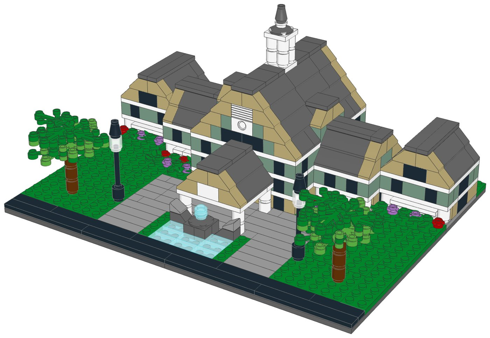
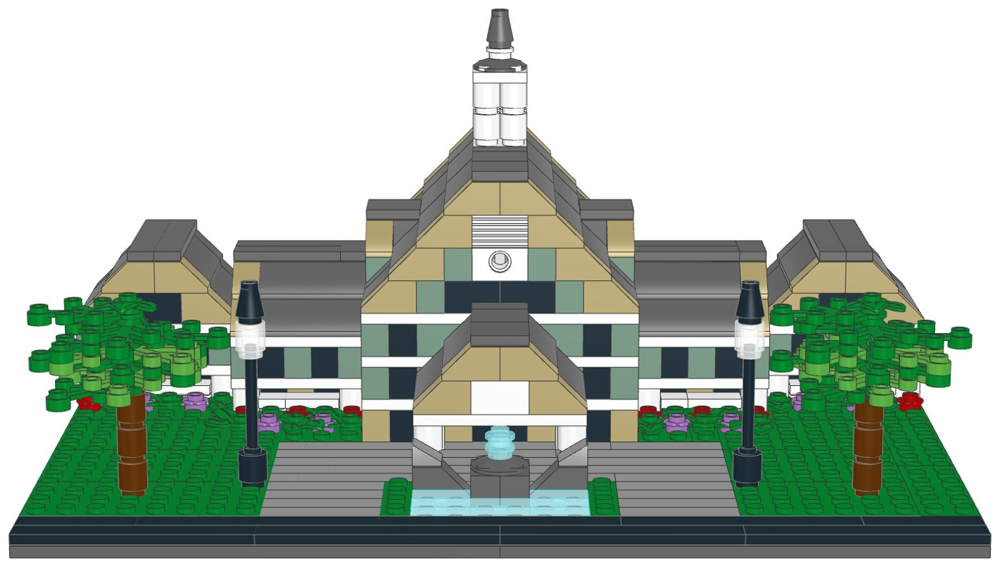
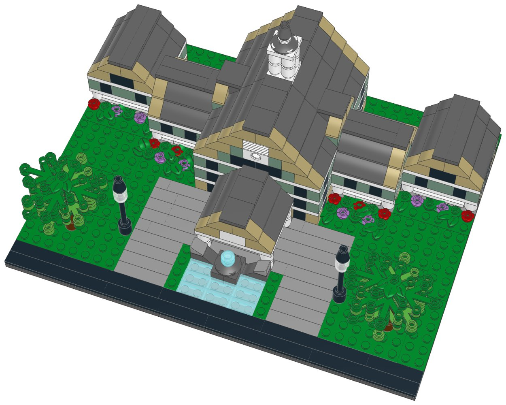

# Saratoga Springs Resort (mid-size): LEGO® display kit with build instructions



A mid-size display model of Disney's Saratoga Springs Resort & Spa at Walt Disney World, part of the [resort collection](../resort-collection/README.md). The arrival front of the Carriage House at Saratoga Springs, built like a Victorian spa-town building in upstate New York: a cream ground floor and sage-green upper floors with white floor bands, under steep dark grey roofs with cream bargeboards. The three-storey central pavilion's tall front gable, with an attic window, a round window and a louvre, crosses a cross-gable that carries on the line of the gabled wings, and a white belvedere with a grey dome and finial stands where the roofs meet. White porches with posts and railings run along the wings, and a porte-cochere with its own steep gable stands over the carriage loop. Lower guest buildings in the same colours, with porches of their own, stand back at either end. In front, water bubbles from a rock in a small spring pool inside the loop, between black lamp posts, flower beds and two shade trees.

This kit covers The Treehouse Villas at Disney's Saratoga Springs Resort as well: they share the property, and the mid-size model shows the part that makes it recognisable.

**Signature features in this kit**

- The Carriage House front, symmetric about the entrance: a cream ground floor and sage-green upper floors with white floor bands
- The three-storey central pavilion, taller than in the compact kit: its tall front gable, with an attic window, a round window and a louvre, crosses a cross-gable under steep dark grey roofs with cream bargeboards
- The white belvedere with a grey dome and finial where the roofs cross
- Two-storey wings with white porches, posts and railings, gabled at the outer ends
- A porte-cochere on white posts with a steep front gable, over the carriage loop
- Two lower guest buildings in cream and sage, set back at either end, with porches of their own
- A spring bubbling from a rock in a clear blue pool, two black lamp posts, flower beds and two shade trees

**Left out**

- The rest of the guest buildings, the Treehouse Villas, the pools and the spa
- The carved gable trusses, the brackets and the Carriage House's back wing
- The lake front and the rest of the gardens

| | |
|---|---|
| Pieces | **561** (70 part/colour lines, 42 kinds of part, 13 colours) |
| Display base | 32 × 24 studs (25.6 × 19.2 cm), the same for every mid-size kit in the collection |
| Overall size | 25.6 × 19.2 cm, 12.6 cm tall |
| Scale | about 1:250 (one storey = 4 plates, 1 stud ≈ 2 m), like the large resort models |
| Instructions | 62-page PDF, 60 steps, 6 sections |
| Parts cost | **$73.00 per kit** at the Pick a Brick prices last seen (2022 and late 2025); about $80.30 with 2026 price rises (see [Cost assumptions](#cost-assumptions-and-resale-scenarios)) |
| Compact version | [`../saratoga-springs-compact-lego`](../saratoga-springs-compact-lego) |



## What's in this folder

| Path | What it is |
|---|---|
| [`instructions/Saratoga_Springs_Resort_Midsize_Instructions.pdf`](instructions/Saratoga_Springs_Resort_Midsize_Instructions.pdf) | **The instruction booklet**: cover, section intros with parts lists, 60 numbered steps, gallery, parts inventory with element IDs, ordering guide |
| [`parts/pick_a_brick_upload.csv`](parts/pick_a_brick_upload.csv) | Pick a Brick upload file for **one kit** (70 element IDs) |
| [`parts/pick_a_brick_upload_x10.csv`](parts/pick_a_brick_upload_x10.csv), [`parts/pick_a_brick_upload_x25.csv`](parts/pick_a_brick_upload_x25.csv) | Upload files for **10 kits** (5,610 pieces) and **25 kits** (14,025 pieces) |
| [`parts/kit_cost.csv`](parts/kit_cost.csv) | Cost of one kit, line by line, with the price and when it was seen |
| [`parts/pick_a_brick_list.csv`](parts/pick_a_brick_list.csv) | Bill of materials: element ID, quantity, part, LEGO colour, design ID, BrickLink part and colour, alternate IDs |
| [`parts/pick_a_brick_mapping.csv`](parts/pick_a_brick_mapping.csv) | Part-by-part sourcing: Pick a Brick name, evidence it's sold, last price, the ID to try next, BrickLink backup |
| [`parts/pick_a_brick_upload_retry.csv`](parts/pick_a_brick_upload_retry.csv) | Newer element IDs for 19 of the parts, for lines the upload doesn't match |
| [`parts/bricklink_wanted_list.xml`](parts/bricklink_wanted_list.xml), [`parts/rebrickable_parts.csv`](parts/rebrickable_parts.csv) | BrickLink wanted list and Rebrickable import (one kit) |
| [`parts/parts_by_section.csv`](parts/parts_by_section.csv) | Parts for each section, for bagging |
| [`model/saratoga_springs_midsize.mpd`](model/saratoga_springs_midsize.mpd) | The digital model (LDraw, with steps and submodels). Opens in BrickLink Studio, LeoCAD and LDCad |
| [`checks.md`](checks.md) | Results of the digital build checks |
| [`design.py`](design.py) | The design, written as code on the stud grid |

## Ordering the parts

1. On lego.com, open **Pick and Build → Pick a Brick** and choose **Upload list**.
2. Upload the file for 1, 10 or 25 kits.
3. Before you pay, check that every line shows the normal (Bestseller) delivery time and compare the bag total with the cost below.
4. If a line isn't matched, use the ID in the retry file or in the "If not found" column of the mapping, multiplied by the number of kits.

**Kits per order:** Pick a Brick sells up to 999 of one element per order. The part this kit uses most is needed 48 times, so one order holds up to **20 kits**.

**Sourcing evidence** (every part must pass the Bestseller-only check in `export_parts.py`):

| Evidence | Lines |
|---|---|
| In Pick a Brick Bestseller range (2022 listing); still in LEGO sets in 2026 | 52 |
| On Pick a Brick (late-2025 listing) | 17 |
| In Pick a Brick Bestseller range (2022 listing); still in LEGO sets in 2026 (including sets listed for 2027) | 1 |

**Sourcing uncertainties:**

- 53 lines are backed only by LEGO's 2022 Bestseller list, so their range and price today are not confirmed.
- 19 lines have newer element IDs (retry file); an upload may match either.
- LEGO pauses Standard parts in the US and Canada from November 2, 2026; this kit uses none, but check that no line shows a longer delivery time.

## Cost assumptions and resale scenarios

These are planning numbers, not quotes. Upload the 10-kit file to see today's prices: the bag total is the real parts cost.

| Assumption | Value |
|---|---|
| Parts, as listed | Pick a Brick prices last seen in LEGO's 2022 Bestseller list and a late-2025 listing (offline data; lego.com could not be reached to check current prices) |
| Parts, 2026 estimate | +10% on the listed prices (stress case +20%); LEGO's September 14, 2026 repricing raised about a third of Pick a Brick elements by 16.7% on average, hitting tiles and small parts hardest |
| Packaging | $3.00 per kit: box, bags, a card with a link or QR code to the PDF booklet, tape and label (a printed colour booklet adds about $4.00) |
| Labour | $15.00/hour; 3 s per piece to count and bag from sorted stock, plus 6 min to pack |
| Etsy fees (US) | $0.20 listing + 6.5% transaction + 3% + $0.25 processing, on the price the buyer pays |
| Shipping | seller-paid (free shipping) $10.50 for a 1-2 lb box by USPS Ground Advantage; or the buyer pays postage |
| Prices | 1.6x / 2x / 2.5x the 2026 parts estimate, rounded up to $x9.99; market prices for custom kits were not researched for each resort |

| Per kit | Listed prices | 2026 estimate | Stress case |
|---|---|---|---|
| Parts | $73.00 | $80.30 | $87.60 |
| Packaging | $3.00 | $3.00 | $3.00 |
| Labour (561 pieces) | $8.51 | $8.51 | $8.51 |
| Before shipping | $84.51 | $91.81 | $99.11 |
| Seller-paid shipping | $10.50 | $10.50 | $10.50 |

Biggest cost lines: 2× Plate 16 x 16 (Dark Stone Grey) $6.08, 32× Slope 45 2 x 4 (Dark Stone Grey) $5.76, 40× Slope 45 2 x 1 (Brick Yellow) $4.40.

| Price | Free shipping (seller pays): profit | margin | Buyer pays postage: profit | margin |
|---|---|---|---|---|
| $129.99 (23¢/piece) | $14.88 | 11% | $24.38 | 19% |
| $169.99 (30¢/piece) | $51.08 | 30% | $60.58 | 36% |
| $209.99 (37¢/piece) | $87.28 | 42% | $96.78 | 46% |

Break-even price: $113.55 with free shipping, $103.05 when the buyer pays postage (2026 estimate). The stress case adds about $7.30 per kit.

## Digital checks and physical prototype

`lego-kit/checks.py` checked the digital model ([`checks.md`](checks.md)):

| Check | Result |
|---|---|
| Collisions | Pass |
| Connections | Pass |
| Assembly order | Pass |
| Stability | Pass |

The model was checked on the computer only: parts fit the stud grid without overlaps and every part is held by a stud. **No physical prototype has been built.** Before selling, build one kit from the uploaded parts and the printed booklet, to confirm the parts arrive as listed, the build holds together when handled, and each step is clear.

## Building notes

- **Sections:**
  1. The display base, the carriage loop and the lawns
  2. The Carriage House
  3. The belvedere
  4. The guest buildings (build 2)
  5. The porte-cochere
  6. The garden: the spring, lamp posts, flower beds and trees
- Each storey is one course of bricks, tan below and sand green above, with black bricks for the windows, then a layer of white plates.
- Plates hidden inside the plinth tie its big plates together before the walls go on.
- The wings' roofs go on before the pavilion's third storey; their inner ends stand against it.
- The pavilion roof and its cross-gable cross: build them one row of slopes at a time, with the tan slopes at the gable ends. Hidden dark grey bricks under the valleys have a step of their own, just before the slopes they hold up.
- The belvedere's finial and the spring's water sit on the centre stud of a 2×2 dome, half a stud off the grid.
- Each lamp post's bar pushes into the hollow stud of the round brick; the clear lantern slides onto the top of the bar.
- A “Build 2” badge means you build that module twice.



## How it was made

The model is generated by [`design.py`](design.py) with the shared toolkit in [`../lego-kit`](../lego-kit), in the collection's mid-size format (`lego-kit/compact.py`). `./build.sh` renders the steps with LeoCAD, maps every part to LEGO element IDs, writes the parts lists and upload files, runs the checks, prints the booklet and writes this README.

```bash
./build.sh            # set DATA_DIR to refresh element IDs (see ../lego-kit/README.md)
```

lego.com, BrickLink and Rebrickable could not be reached from the environment this was made in. Availability comes from an August 2026 Rebrickable snapshot and Pick a Brick listings from 2022 and late 2025. With internet access, `node ../lego-kit/pab_check.cjs .` checks every element live.

## Disclaimer

An unofficial fan design (MOC) inspired by Disney's Saratoga Springs Resort & Spa at Walt Disney World. It is not affiliated with, sponsored or endorsed by The LEGO Group or Disney. LEGO® is a trademark of The LEGO Group. Resort names are trademarks of Disney; see the trademark note in the [collection README](../resort-collection/README.md) before selling.
