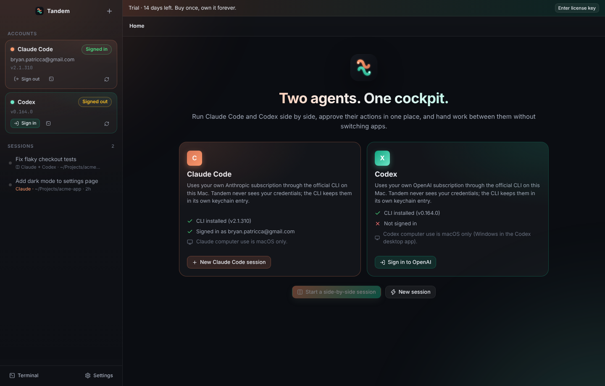

# Tandem

**One cockpit for Claude Code and Codex.** Tandem is a native macOS desktop app that drives the
Claude Code CLI (Anthropic) and the Codex CLI (OpenAI) side by side: one timeline, one approval
queue, one composer. You keep paying Anthropic and OpenAI for the subscriptions you already have;
Tandem is a one-time purchase that makes them work as a team.



## What it does

| Capability | Claude Code | Codex |
| --- | --- | --- |
| Streamed replies, tool calls, diffs, shell output | stream-json protocol over stdin/stdout | app-server JSON-RPC (`codex app-server --stdio`) |
| Approvals in the UI (allow once / always / deny with a reason) | `can_use_tool` control requests | `item/commandExecution/requestApproval`, `item/fileChange/requestApproval`, `item/permissions/requestApproval` |
| Clarifying questions | `AskUserQuestion` | `item/tool/requestUserInput` |
| Permission posture (Ask / Auto-edit / Full auto / Plan) | `--permission-mode` + `set_permission_mode` | `approvalPolicy` + `sandboxPolicy` on `turn/start` |
| Model and effort switching | `set_model`, `--effort` | `model` / `effort` on `turn/start`, `model/list` |
| Computer use (see and control the screen) | interactive CLI in the built-in terminal; Tandem enables the `computer-use` MCP server for the project | `features.computer_use` on the thread + a developer instruction |
| Browser use | `--chrome` (Claude in Chrome) | `features.browser_use` |
| Resume conversations | `--resume <session id>` | `thread/resume` |
| Sign-in detection | `claude auth status`, `~/.claude.json`, SDK `initialize` → account | `account/read`, `account/login/start` (opens the ChatGPT OAuth page), `account/rateLimits/read` |
| Usage meters | rate-limit events | 5-hour / weekly windows from `account/rateLimits/read` |

Plus:

- **Side-by-side mode.** Send the same prompt to both agents and compare them in split view.
- **Hand-off.** One click sends the task, the original request, and the last update to the other agent in a fresh session in the same folder.
- **Embedded terminal.** Open the raw `claude` or `codex` TUI in a tab when you want the native experience (and for Claude computer use, which the CLI only offers interactively).
- **Session history** persisted locally, with cost, token and context meters.
- **Offline licensing.** Ed25519-signed keys, 14-day trial, no server, no telemetry.

## How it talks to the CLIs

Tandem never calls Anthropic or OpenAI APIs itself and never touches your credentials. Each
agent runs as the official CLI, signed in with your own account:

- **Claude Code** is spawned as
  `claude -p --input-format stream-json --output-format stream-json --verbose --include-partial-messages --permission-prompt-tool stdio --permission-mode <mode> --session-id <uuid>`.
  Tandem sends `{"type":"user",...}` turns, answers `control_request/can_use_tool` with
  `control_response`, and uses `control_request` subtypes `initialize`, `interrupt`,
  `set_permission_mode`, `set_model`. Verified against Claude Code 2.1.310.
- **Codex** runs one shared `codex app-server --stdio`. Tandem speaks JSON-RPC 2.0 over NDJSON:
  `initialize` → `initialized`, `thread/start|resume`, `turn/start|steer|interrupt`, and reacts to
  `item/*`, `turn/*`, `thread/tokenUsage/updated`, `account/*` notifications. Approval requests
  arrive as server→client requests and are answered by id. Verified against Codex CLI 0.164.0.
  Regenerate the protocol types with `codex app-server generate-ts --out <dir>` when upgrading.

### Computer use, honestly

- **Codex**: the `computer_use` feature flag is stable and on by default in Codex 0.164. Tandem sets
  it on the thread and tells the model the user wants screen control. Codex controls only the apps
  you allow under `computer_use.macos.bundle_ids` in `~/.codex/config.toml` (macOS only).
- **Claude Code**: computer use is a built-in MCP server (`computer-use`) that is macOS-only, needs
  a Pro or Max plan, and is **not available in `-p` (headless) mode**. Tandem therefore enables the
  server for the project (the same thing `/mcp → Enable` does, by adding `computer-use` to
  `projects[cwd].enabledMcpServers` in `~/.claude.json`) and opens an interactive `claude` session in
  the embedded terminal when you turn the toggle on. macOS will ask for Accessibility and Screen
  Recording permission the first time.

## Development

```bash
cd tandem
npm install          # downloads Electron; node-pty is rebuilt for Electron by electron-builder
npm run dev          # electron-vite dev server with HMR
npm run typecheck
npm test             # unit tests
TANDEM_LIVE=1 npm run test:live   # protocol tests against your real claude / codex binaries
```

If `node-pty` fails to build for Electron on your machine, run `npm run rebuild` (it needs the
Electron headers; Xcode Command Line Tools on macOS). The app still runs without it; the embedded
terminal falls back to a plain pipe.

### Screenshots / smoke test

```bash
npm run build
node e2e/screenshot.mjs --demo     # launches the built app via Playwright and writes e2e/shots/*.png
```

## Building the Mac app

```bash
npm run dist:mac          # current arch → release/Tandem-<version>-<arch>.dmg (+ .zip)
npm run dist:mac:all      # arm64 and x64
```

`electron-builder.yml` targets macOS 12+, enables hardened runtime and dark mode. For distribution
outside your own machine, sign and notarize with your Apple Developer ID: set `CSC_LINK` /
`CSC_KEY_PASSWORD` and `APPLE_ID` / `APPLE_APP_SPECIFIC_PASSWORD` / `APPLE_TEAM_ID` in the
environment before `npm run dist:mac`. Unsigned builds run locally after right-click → Open.

## Selling it (pay once, own it)

1. `npm run license:keygen` once. It writes `.tandem-license-private.pem` (keep it private) and
   prints a public key. Paste that into `PUBLIC_KEY_PEM` in `src/main/services/license.ts`
   and rebuild. The committed key is a throwaway development key.
2. For each purchase: `npm run license:sign -- --licensee "Jane Doe" --email jane@example.com`
   prints a `TANDEM-…` key. Email it with the download link. Any storefront that can run a
   script on purchase (Lemon Squeezy, Paddle, Gumroad, Stripe webhooks) can call this.
3. The buyer pastes the key under **Settings → License**. Verification is offline (Ed25519), so
   the app works forever without a server. Nothing phones home.

Tandem does not resell Anthropic or OpenAI access. Buyers bring their own Claude and ChatGPT
subscriptions, sign in through the official CLIs, and Tandem detects that sign-in.

## Layout

```
tandem/
  src/main/                 Electron main process
    agents/claude/          Claude Code stream-json adapter
    agents/codex/           Codex app-server JSON-RPC client + session adapter
    services/               detection/auth, sessions, persistence, terminals, license, settings
  src/preload/              contextBridge → window.tandem
  src/renderer/             React UI (zustand store, timeline, approvals, composer, terminal)
  src/shared/               types + IPC contract shared by both sides
  scripts/                  license keygen / signing
  tests/                    unit tests; tests/live hits the real CLIs
  e2e/                      Playwright-driven screenshot smoke test
```
